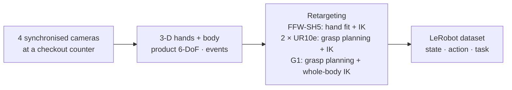

<div align="center">

# ARCADE

**ARCADE** · **A**ctivity **R**ecognition in **C**ommercial **A**reas with **D**etailed **E**vents

**Teach robots to handle everyday products, from real human demonstrations.**

**3-D hands, product 6-DoF and every grasp and release, captured without markers and replayed on robots, ready to train on.**

[](LICENSE) [](docs/DATASETS.md) [](https://www.python.org/) [](https://github.com/huggingface/lerobot)

[](https://huggingface.co/SpaceVision-AI)


<sub>Left: a recorded shopper picks up a bottle with the left hand and passes it to the right hand, as 3-D body,
hands and product pose. Right: the same episode on the ROBOTIS FFW-SH5 humanoid, from the released joint trajectories.</sub>

</div>

ARCADE captures how people handle products in commercial areas, in 3-D and to the frame, and
turns it into training data for robots. **ARCADE-Checkout** is its self-checkout dataset: a
shopper picks products up from the counter, inspects them, passes them between hands and puts them
down.

## Why ARCADE-Checkout

**Teleoperation doesn't scale. Ordinary human video has no 3-D and no robot actions. So where does manipulation data come from?**

From people handling everyday products the way they naturally would. Four synchronised
third-person (exocentric) cameras record real human demonstrations at a self-checkout counter,
with no teleoperation. These everyday motions are the building blocks of hand and gripper
manipulation, and each one is reconstructed in 3-D.

**One human demonstration. Why stop at one robot?**

ARCADE doesn't. The same episodes are already retargeted to a humanoid with 20-joint dexterous
hands (ROBOTIS FFW-SH5), a whole-body humanoid with three-finger hands (Unitree G1) and two UR10e
cobots with two-finger grippers; 40 of them are on all three. Adding a robot means retargeting the
same recordings, not recording again, and every robot step links back to the human frame it came
from. LeRobot format: load it and train.

**What do you get?**

| | |
|---|---|
| **Nothing to wear** | Four fixed cameras watch the counter. The shopper wears no headset, gloves or markers, so the motion is natural, and the same setup can be installed at other counters to collect more |
| **Every product in 6-DoF** | Each product is a measured, textured mesh posed in 3-D at every frame, with a per-frame score of how well the pose matches the camera views |
| **Every grasp and release, to the frame** | Per-hand grasp and release events, holding and carrying intervals, and hand-overs between the two hands in half of the episodes, a motion few public datasets label frame by frame |

**Is it for you?**

* **Robot foundation model and policy teams**: human and robot trajectories of the same episodes,
  paired step by step, in LeRobot format, for adapting what is learned from people to a specific
  robot.
* **Humanoid, dexterous-hand and cobot makers**: see the same human motion on robots like yours,
  and what it would take to retarget it to yours.
* **Simulation and synthetic-data teams**: real human motion to seed synthetic data, with
  measured product meshes.
* **Research labs**: frame-level grasp, release and hand-over labels for hand–object and
  retargeting research.

## What is in this repository

```
ARCADE-Checkout/
├── docs/                 datasheets, glossary
├── human/                human data: reader, validator, renderers (pip package arcade-human)
│   ├── samples/          2 episodes in the release format
│   └── docs/             format, coordinate frames, method
├── robots/               robot data: LeRobot exporter, FFW-SH5 retargeting solver, renderer (pip package arcade-retarget)
│   ├── samples/          2 episodes per robot: LeRobot v3.0 and v2.1, raw outputs
│   ├── retarget/         one folder per robot: fetches its description from the maker's repository
│   │   ├── robotis_ffw_sh5/
│   │   ├── universal_robots_ur10e_robotiq_2f140/
│   │   └── unitree_g1_dex3/
│   └── docs/             formats, retargeting methods
└── data/                 the full datasets, once downloaded from Hugging Face (not in git)
```

## Start here

Every dataset ships a 2-episode sample in the exact release format, so one clone is enough:

```bash
git clone https://github.com/SpaceVision-ai/ARCADE-Checkout.git && cd ARCADE-Checkout
pip install -e ./human -e ./robots      # both packages; LeRobot users need neither
```

| you want to … | first step | time |
|---|---|---|
| train or evaluate a robot policy | [robots → Load the sample with LeRobot](robots/README.md#load-the-sample-with-lerobot): `LeRobotDataset("local/arcade_ffw_sh5", root="robots/samples/lerobot_ffw_sh5_v3.0")`, or `samples/lerobot_ur10e_2f140_v3.0` for the UR10e arms, `samples/lerobot_g1_dex3_v3.0` for the G1 | 5 min |
| study human hand–object motion, or retarget it to your own robot | [human → Try it on the sample](human/README.md#try-it-on-the-sample): `arcade-human info human/samples/arcade_human_sample` | 2 min |
| check the exact fields | [human data format](human/docs/FORMAT.md) · [robot data format](robots/docs/FORMAT.md) | 10 min |
| decide whether ARCADE fits your project | [datasheets](docs/DATASETS.md), then the table below | 5 min |

## Get the full datasets

The full datasets are on Hugging Face under [SpaceVision-AI](https://huggingface.co/SpaceVision-AI), with gated
access: request access on a dataset's page, then log in once with `hf auth login` (`pip install huggingface_hub`).
Download them into `data/` at the repository root. Git ignores it, and the examples in this repository use these paths.

| dataset | on Hugging Face | download into | contents |
|---|---|---|---|
| human | [ARCADE-Checkout-Human](https://huggingface.co/datasets/SpaceVision-AI/ARCADE-Checkout-Human) | `data/ARCADE-Checkout-Human` | `data/`, `meta/`, `objects/` (49 MB); `segmentation/`: masks, one zip per episode (2.7 GB) |
| ROBOTIS FFW-SH5 | [ARCADE-Checkout-FFW-SH5](https://huggingface.co/datasets/SpaceVision-AI/ARCADE-Checkout-FFW-SH5) | `data/ARCADE-Checkout-FFW-SH5` | LeRobot v3.0 (`data/`, `meta/`) and the raw outputs (`raw/`) |
| 2 × UR10e + Robotiq 2F-140 | [ARCADE-Checkout-UR10e](https://huggingface.co/datasets/SpaceVision-AI/ARCADE-Checkout-UR10e) | `data/ARCADE-Checkout-UR10e` | the same layout |
| Unitree G1 + Dex3-1 | [ARCADE-Checkout-G1](https://huggingface.co/datasets/SpaceVision-AI/ARCADE-Checkout-G1) | `data/ARCADE-Checkout-G1` | the same layout |

```bash
hf download SpaceVision-AI/ARCADE-Checkout-Human --repo-type dataset --local-dir data/ARCADE-Checkout-Human \
    --exclude "segmentation/*"                    # leave out --exclude to get the masks too
hf download SpaceVision-AI/ARCADE-Checkout-G1 --repo-type dataset --local-dir data/ARCADE-Checkout-G1   # likewise FFW-SH5, UR10e

arcade-human info data/ARCADE-Checkout-Human
```

LeRobot can also load a robot dataset straight from the Hub, without `data/`. LeRobot 0.3.x gets the v2.1 copy of the
same dataset:

```python
from lerobot.datasets.lerobot_dataset import LeRobotDataset
ds = LeRobotDataset("SpaceVision-AI/ARCADE-Checkout-G1")
```

## What happens in an episode

An episode is one product handled at the counter, from its first grasp until both hands have
released it, with some context before and after. The human data labels it per hand:

* **`grasp` and `release` events**: the instants a hand takes and lets go of the product.
* **Carrying interval** (`carrying`): the frames in which the product moves with that hand. One
  hand carries at a time; in a hand-over the product passes from one hand's interval to the other's.
* **Holding interval** (`holding`): from the hand's grasp to its release, so during a hand-over
  both hands hold.

From these labels each hand is, at every frame, in one of four phases. The episode's first grasp
is where its first carrying interval starts, which can be a few frames after the first `grasp`
event.

| phase (per hand) | when | what the hand does |
|---|---|---|
| 0. before the grasp | until 6 frames before the episode's first grasp | moves toward the product. The robot's wrist path is shifted so the hand clears the product and the counter |
| 1. just before the grasp | the last 6 frames before the episode's first grasp | arrives at the product. The robot's clearance shift fades out |
| 2. hold | the hand's carrying interval | the product moves with this hand |
| 3. after | after the episode's first grasp, outside the hand's carrying interval | the hand does not carry: it waits for a hand-over, has passed the product on, or has put it down. After its last release the robot hand backs off the product |

The robot data uses the same phases, through the session frame of each step (`source_frame`).
Example, the pass in the video above (`J03826_left`):

| hand | human frames | robot steps |
|---|---|---|
| left (picks up, passes) | 0: 0–37 · 1: 38–43 · 2: 44–110 · 3: 111–167 | 0: 0–61 · 1: 62–69 · 2: 70–138 · 3: 139–204 |
| right (takes over, puts down) | 0: 0–37 · 1: 38–43 · 3: 44–110 · 2: 111–127 · 3: 128–167 | 0: 0–61 · 1: 62–69 · 3: 70–138 · 2: 139–155 · 3: 156–204 |

The robot leaves its home pose in phase 0 and returns to it in phase 3 (raw outputs:
`<hand>__w`). Whether the product changes hands is a property of the episode, not a phase:
`task_kind` (`pass`, `both_hands`, `one_hand`, `repeated`) and the language task record it.
In the UR10e and G1 data, `left_carrying` / `right_carrying` mark a gripper or hand that holds the
product (both during a hand-over), and the raw outputs keep each arm's or hand's own approach, hold
and retreat.

## What you can use today

| | human data (`human/`) | robot data (`robots/`) |
|---|---|---|
| In the repository now | 2 episodes in the release format, and the code | 2 episodes per robot in LeRobot v3.0 and v2.1 plus the raw outputs, and the code |
| Full dataset | release 1.0.0: 97 episodes, 49 MB (+ 2.7 GB masks), on [Hugging Face](https://huggingface.co/datasets/SpaceVision-AI/ARCADE-Checkout-Human) (gated access). RGB camera video will be released after de-identification | release 1.0.0: FFW-SH5 94 episodes, 11 MB; two UR10e + 2F-140 45 episodes, 6 MB; Unitree G1 + Dex3-1 80 episodes, 6 MB. On Hugging Face, gated access: [ARCADE-Checkout-FFW-SH5](https://huggingface.co/datasets/SpaceVision-AI/ARCADE-Checkout-FFW-SH5), [ARCADE-Checkout-UR10e](https://huggingface.co/datasets/SpaceVision-AI/ARCADE-Checkout-UR10e), [ARCADE-Checkout-G1](https://huggingface.co/datasets/SpaceVision-AI/ARCADE-Checkout-G1) |
| Format | HDF5 · JSON · OBJ · PNG | LeRobot (parquet), state only |
| Good for | grasp and hand-over timing, bimanual coordination, product pose tracking, retargeting to robot hands | prototyping and evaluating state-based policies for a mobile bimanual humanoid, a whole-body humanoid with three-finger hands, or two arms with parallel grippers; retargeting research |
| Not suitable for | — | running on hardware without physical validation (the trajectories are kinematic; only the G1 grasps are tested in a physics replay); contact-rich control (FFW-SH5 hand–product contact is not modelled) |

## At a glance

| | figure | what it means |
|---|---|---|
| Demonstrations | **97** episodes of one product each, 5.1 to 12.3 s; 7.2 min of unique motion | one person handling 5 products: enough to prototype and compare methods, too small to train a general policy on its own |
| Behaviours | 49 hand-to-hand passes, 10 both-hands holds, 37 one-hand, 1 picked up twice | half of the episodes contain a pass from one hand to the other |
| Labels | **360** grasp/release events; per-hand holding and carrying intervals; **263,441** segmentation masks | event times and holding intervals agree within one frame (358 of 360), so either can be used for timing |
| Human 3-D quality | product pose vs. camera masks: IoU median 0.91 while held; 98 % of frames ≥ 0.5 | the posed product mesh lines up with what the cameras see; `object/mask_iou` marks the frames where it does not |
| Robot: FFW-SH5 | ROBOTIS AI Worker FFW-SH5 (2 × 7-DoF arms, 2 × 20-joint hands, head, lift, swerve base): **94** episodes, 18,119 steps at 20 fps, 11 language tasks | where the arm cannot keep up, the robot is slowed down: it moves about 20 % slower than the shopper |
| FFW-SH5 quality | hand within 2.4 mm of its planned target (median); no joint beyond the URDF limits; part of the hand inside the product in 34 % of the holding time | the arms go where they are planned to; hand–product contact is the weak point and needs refinement for physics |
| Robot: 2 × UR10e | two Universal Robots UR10e arms with Robotiq 2F-140 grippers on fixed bases: **45** two-handed episodes that pass the robot check, 42,087 steps at 20 fps, 10 language tasks | planned around grasps and re-timed to the UR10e joint speed limits: the robot is slower than the shopper (median 3.7 robot steps per human frame) |
| UR10e quality | the upstream URDF reproduces the recorded gripper poses to 0.0002 mm; no joint beyond its limits; arm meshes never touch; gripper at most 7.9 mm inside the held product | the motion is consistent with the robot model and free of arm–arm contact; there is no physics validation |
| Robot: G1 | Unitree G1 humanoid (29 body joints, free-floating pelvis) with Dex3-1 three-finger hands: **80** episodes that pass the robot check, 10,505 steps at 20 fps, 12 language tasks | whole-body: legs, waist, arms and hands solved together, feet in place; it follows the shopper's clock, slowed only around hand-over grabs |
| G1 quality | centre of mass inside the feet's support polygon at every step; no joint beyond its position limits; the robot hand grips the product in 99.9 % of its holding steps; **45 of 80** episodes keep the product in every hold in a MuJoCo replay of the grasps (`physics_all_held`) | the grasps are physically plausible in about half of the episodes; most losses are two-hand hand-overs |


## How the data is made



Human motion and product poses are reconstructed automatically from calibrated multi-view
video. The robot data is derived from them kinematically: no teleoperation and no learned
model. Details: [human/docs/METHOD.md](human/docs/METHOD.md) ·
[robots/docs/RETARGETING.md](robots/docs/RETARGETING.md) (FFW-SH5) ·
[robots/docs/RETARGETING_UR10E.md](robots/docs/RETARGETING_UR10E.md) (UR10e) ·
[robots/docs/RETARGETING_G1.md](robots/docs/RETARGETING_G1.md) (G1).

## Citation and license

* Cite via [`CITATION.cff`](CITATION.cff) (GitHub's "Cite this repository").
* Code and data: [CC BY-NC 4.0](LICENSE) (Creative Commons Attribution-NonCommercial 4.0). You may use,
  share and adapt them for non-commercial purposes, with attribution. For commercial use, [write to us](#contact).
* The full datasets on Hugging Face ([SpaceVision-AI](https://huggingface.co/SpaceVision-AI)) are under the same license.
* The license covers our measurements and annotations. The packaging artwork in the product mesh textures
  belongs to the product makers and is not licensed under CC BY-NC 4.0.
* The robot meshes in the robot images and videos stay under their makers' licenses
  ([THIRD_PARTY_LICENSES.md](robots/THIRD_PARTY_LICENSES.md#robot-images-and-videos)).

## Acknowledgements

The robot data is built on robot models published by their makers and the ROS community:

* [ROBOTIS AI Worker](https://github.com/ROBOTIS-GIT/ai_worker) (FFW-SH5): Apache-2.0 license
* [Universal Robots ROS2 Description](https://github.com/UniversalRobots/Universal_Robots_ROS2_Description) (UR10e): BSD-3-Clause license
* [ROS-Industrial Robotiq](https://github.com/ros-industrial-attic/robotiq) (2F-140 gripper): BSD-2-Clause license
* [Unitree ROS](https://github.com/unitreerobotics/unitree_ros) (G1 with Dex3-1 hands): BSD-3-Clause license

## Contact

Interested in the datasets for commercial use? Write to us at
[contact@space-vision.ai](mailto:contact@space-vision.ai). For non-commercial use, request access on
[Hugging Face](https://huggingface.co/SpaceVision-AI). For questions about the data or the code, open an
[issue](https://github.com/SpaceVision-ai/ARCADE-Checkout/issues).

---

<sub>**Overview** · [human](human) (human data) · [robots](robots) (robot data) · [glossary](docs/GLOSSARY.md)</sub>
