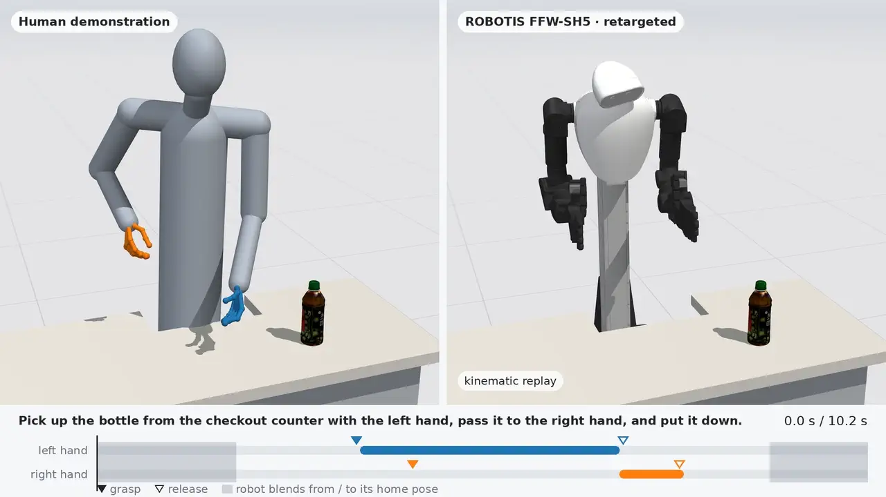
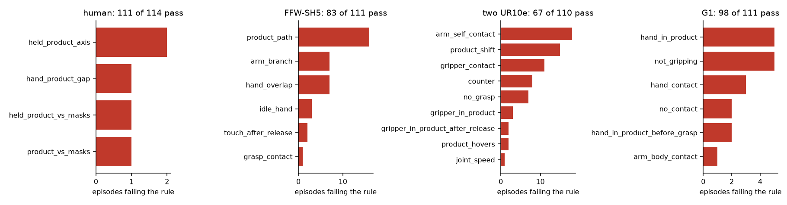
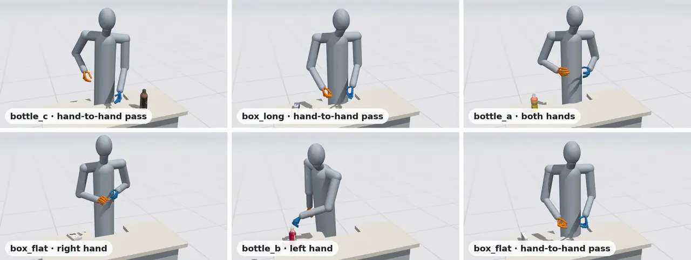
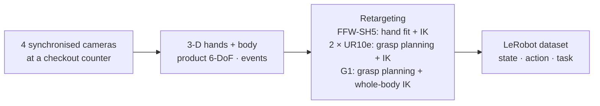

<div align="center">

# ARCADE

**ARCADE** · **A**ctivity **R**ecognition in **C**ommercial **A**reas with **D**etailed **E**vents

## Don't teleoperate the checkout. Watch people work it.

**Real human behaviour at a self-checkout counter, reconstructed in 3-D and retargeted to three robots.**

**Hands, body, product 6-DoF and every grasp, release and hand-over, captured without markers or wearables, as robot trajectories in LeRobot format.**

[](LICENSE) [](docs/DATASETS.md) [](https://www.python.org/) [](https://github.com/huggingface/lerobot)

[](https://huggingface.co/SpaceVision-AI)



<sub>Left: a recorded shopper picks up a bottle with the left hand and passes it to the right hand, as 3-D body,
hands and product pose. Right: the same episode on the ROBOTIS FFW-SH5 humanoid, from the released joint trajectories.</sub>

</div>

ARCADE captures how people handle products in commercial areas, in 3-D and to the frame, and
turns it into training data for robots. **ARCADE-Checkout** is its self-checkout dataset: a
shopper picks products up from the counter, inspects them, passes them between hands and puts them
down. This release is one session with one shopper, recorded at a self-checkout counter set up in
our lab.

## Why ARCADE-Checkout

**Teleoperation doesn't scale. Ordinary human video has no 3-D and no robot actions. So where does manipulation data come from?**

From the work people already do with their hands. At a self-checkout counter a person picks a
product up, turns it over, passes it from one hand to the other and puts it down, one product after
another. ARCADE records that behaviour with fixed third-person cameras, with no teleoperation and
nothing to wear, and reconstructs each motion in 3-D.

**What starting from real checkout behaviour buys you**

| | |
|---|---|
| **The task itself, not a stand-in** | The demonstrations are the handling a checkout robot would have to do (pick up, inspect, pass between hands, put down), in the order and at the pace a person does it, cut from one continuous session |
| **How people really use two hands** | Half of the passing episodes pass the product from hand to hand, and others hold it with both hands: bimanual coordination that is hard to teleoperate |
| **Natural motion** | The shopper wears no headset, gloves or markers and operates no robot, so reach, grasp and release keep their natural timing |
| **Retail products** | Bottles and boxes with the measured dimensions of retail products, each posed in 6-DoF at every frame |
| **One recording, many robots** | The same human episodes are retargeted to a dexterous humanoid, a three-finger humanoid and two gripper arms; another robot means another retargeting, not another recording |

**One human demonstration. Why stop at one robot?**

ARCADE doesn't. One human reconstruction feeds three robots: a humanoid with 20-joint dexterous
hands (ROBOTIS FFW-SH5), a whole-body humanoid with three-finger hands (Unitree G1) and two UR10e
cobots with two-finger grippers. All three are built from the same human release, and 49 episodes
pass the check on all three. Adding a robot means retargeting the same recordings, not recording
again, and every robot step records the session frame of the human recording it came from.
LeRobot format: load it with the stock tools.

**What do you get?**

| | |
|---|---|
| **Nothing to wear** | Four fixed cameras watch the counter. The shopper wears no headset, gloves or markers, so the motion is natural, and the same setup can be installed at other counters to collect more |
| **Every product in 6-DoF** | Each product is a mesh with measured dimensions and a de-identified texture, posed in 3-D at every frame, with a per-frame score of how well the pose agrees with the camera masks |
| **Every grasp and release, to the frame** | Per-hand grasp and release events, holding and carrying intervals, and hand-overs between the two hands in half of the episodes, a motion few public datasets label frame by frame |
| **Every episode, with its check** | Nothing is filtered out: each episode carries the result of an automatic check (`check_passed`, `check_failed`), for the human data and for each robot |

**Is it for you?**

* **Robot foundation model and policy teams**: human and robot trajectories of the same episodes,
  paired step by step, in LeRobot format, for adapting what is learned from people to a specific
  robot.
* **Humanoid, dexterous-hand and cobot makers**: see the same human motion on robots like yours,
  and what it would take to retarget it to yours.
* **Simulation and synthetic-data teams**: real human motion to seed synthetic data, with
  product meshes with measured dimensions.
* **Research labs**: frame-level grasp, release and hand-over labels for hand–object and
  retargeting research.

## What is in this repository

```
ARCADE-Checkout/
├── docs/                 datasheets, glossary
├── human/                human data: reader, validator, renderers (pip package arcade-human)
│   ├── samples/          4 episodes in the release format, with their product masks
│   └── docs/             format, coordinate frames, method
├── robots/               robot data: LeRobot exporter, robot description fetchers, renderer (pip package arcade-retarget)
│   ├── samples/          the same 3 episodes per robot: LeRobot v3.0 and v2.1, raw outputs
│   ├── retarget/         one folder per robot: fetches its description from the maker's repository
│   │   ├── robotis_ffw_sh5/
│   │   ├── universal_robots_ur10e_robotiq_2f140/
│   │   └── unitree_g1_dex3/
│   └── docs/             formats, retargeting methods
└── data/                 the full datasets, once downloaded from Hugging Face (not in git)
```

## Start here

Every dataset ships a small sample in the exact release format (4 human episodes; the same 3 episodes on
every robot), so one clone is enough:

```bash
git clone https://github.com/SpaceVision-ai/ARCADE-Checkout.git && cd ARCADE-Checkout
pip install -e ./human -e ./robots      # both packages; LeRobot users need neither
```

| you want to … | first step | time |
|---|---|---|
| train or evaluate a robot policy | [robots → Load the sample with LeRobot](robots/README.md#load-the-sample-with-lerobot): `LeRobotDataset("local/arcade_ffw_sh5", root="robots/samples/lerobot_ffw_sh5_v3.0")`, or `root="robots/samples/lerobot_ur10e_2f140_v3.0"` for the two UR10e arms, `root="robots/samples/lerobot_g1_dex3_v3.0"` for the G1 | 5 min |
| study human hand–object motion, or retarget it to your own robot | [human → Try it on the sample](human/README.md#try-it-on-the-sample): `arcade-human info human/samples/arcade_human_sample` | 2 min |
| check the exact fields | [human data format](human/docs/FORMAT.md) · [robot data format](robots/docs/FORMAT.md) | 10 min |
| decide whether ARCADE fits your project | [datasheets](docs/DATASETS.md), then the tables below | 5 min |

Every path in this file is relative to the repository root.

## Get the full datasets

The full datasets are on Hugging Face under [SpaceVision-AI](https://huggingface.co/SpaceVision-AI), with gated
access: request access on a dataset's page, then log in once with `hf auth login` (`pip install huggingface_hub`).
Download them into `data/` at the repository root. Git ignores it, and the examples in this repository use these paths.
The Hugging Face datasets are updated to 1.1.0 as part of this release. The version of a download is in
`meta/info.json -> release_version` (human) and `meta/arcade.json -> retarget.version` (robots: the human release they were built from).

| dataset | on Hugging Face | download into | contents |
|---|---|---|---|
| human | [ARCADE-Checkout-Human](https://huggingface.co/datasets/SpaceVision-AI/ARCADE-Checkout-Human) | `data/ARCADE-Checkout-Human` | `data/`, `meta/`, `objects/` (41 MB); `segmentation/`: the masks for every episode, one zip per episode |
| ROBOTIS FFW-SH5 | [ARCADE-Checkout-FFW-SH5](https://huggingface.co/datasets/SpaceVision-AI/ARCADE-Checkout-FFW-SH5) | `data/ARCADE-Checkout-FFW-SH5` | LeRobot v3.0 (`data/`, `meta/`) and the raw outputs (`raw/`) |
| 2 × UR10e + Robotiq 2F-140 | [ARCADE-Checkout-UR10e](https://huggingface.co/datasets/SpaceVision-AI/ARCADE-Checkout-UR10e) | `data/ARCADE-Checkout-UR10e` | the same layout |
| Unitree G1 + Dex3-1 | [ARCADE-Checkout-G1](https://huggingface.co/datasets/SpaceVision-AI/ARCADE-Checkout-G1) | `data/ARCADE-Checkout-G1` | the same layout |

```bash
hf download SpaceVision-AI/ARCADE-Checkout-Human --repo-type dataset --local-dir data/ARCADE-Checkout-Human \
    --exclude "segmentation/*"                    # leave out --exclude to get the masks too
hf download SpaceVision-AI/ARCADE-Checkout-G1 --repo-type dataset --local-dir data/ARCADE-Checkout-G1   # likewise FFW-SH5, UR10e

arcade-human info data/ARCADE-Checkout-Human
```

LeRobot can also load a robot dataset straight from the Hub, without `data/`. LeRobot 0.3.x gets the v2.1 copy of the
same dataset:

```python
from lerobot.datasets.lerobot_dataset import LeRobotDataset
ds = LeRobotDataset("SpaceVision-AI/ARCADE-Checkout-G1")
```

## What happens in an episode

An episode is one product handled at the counter, from its first grasp until both hands have
released it, with some context before and after. The human data labels it per hand:

* **`grasp` and `release` events**: the instants a hand takes and lets go of the product.
* **Holding interval** (`holding`): from the hand's grasp to its release, so during a hand-over
  both hands hold.
* **Carrying interval** (`carrying`): the frames in which the product moves with that hand. One
  hand carries at a time; in a hand-over the product passes from one hand's interval to the other's.

From the holding intervals each hand is, at every frame, in one of four phases. The episode's first
grasp is the start of its first holding interval. The last column applies to the FFW-SH5 data
only: it is the robot that follows the shopper's hands frame by frame.

| phase (per hand) | when | what the hand does | FFW-SH5 only |
|---|---|---|---|
| 0. before the grasp | until 6 frames before the episode's first grasp | moves toward the product | the robot leaves its home pose; where needed, its wrist path is shifted so the hand clears the product and the counter |
| 1. just before the grasp | the last 6 frames before the episode's first grasp | arrives at the product | |
| 2. hold | the hand's holding interval | holds the product, from its grasp to its release. During a hand-over both hands are in this phase | the fingers are on the product surface, thumb opposite the fingers; the product is attached to the robot hand that carries it, and that hand keeps its grasp |
| 3. after | after the episode's first grasp, outside the hand's holding interval | does not hold: it waits for a hand-over, has passed the product on, or has put it down | at a release the fingers peel off and the hand lifts away before it retreats; after the last release the robot returns to its home pose |

The robot data uses the same phases. The last two values of `observation.environment_state` are
**`left_holding`** and **`right_holding`**: 1 while that robot hand, arm or gripper holds the
product, and both 1 during a hand-over. The meaning is the same on all three robots. `source_frame`
gives the session frame of every step, so any step can be traced back to the human data.

Example, the pass in the video above (`J03826_left`, in the samples), from
`interaction/<hand>/holding` in the human sample and from `left_holding`, `right_holding` and
`source_frame` in the FFW-SH5 sample ([code](robots/README.md#load-the-sample-with-lerobot)):

| hand | human frames (168) | FFW-SH5 steps (331) |
|---|---|---|
| left (picks up, passes) | 0: 0–37 · 1: 38–43 · 2: 44–113 · 3: 114–167 | 0: 0–61 · 1: 62–68 · 2: 69–159 · 3: 160–330 |
| right (takes over, puts down) | 0: 0–37 · 1: 38–43 · 3: 44–58 · 2: 59–127 · 3: 128–167 | 0: 0–61 · 1: 62–68 · 3: 69–83 · 2: 84–194 · 3: 195–330 |

Both hands hold during the hand-over: human frames 59–113, robot steps 84–159. Which of the two hands
the product moves with is the carrying interval (human `interaction/<hand>/carrying`; FFW-SH5 raw
outputs `carrying` and `obj_carrier`). Whether the product changes hands is a property of the episode,
not a phase: `task_kind` and the language task record it. The holds are the robot's own: on the UR10e
arms and the G1 a grasp is planned per hold, and the raw outputs keep each hold as a run of steps
(`PREFIX_obj.json -> holding`).

### How the three robots differ

All three robot datasets come from the same human episodes, but the robots do not follow the shopper in the same way:

* **FFW-SH5** (20-joint five-finger hands): the hands follow the shopper's hand pose and finger shape
  frame by frame, with the fingers solved onto the product while holding. The product is attached to
  the robot hand while carried. The timeline is slowed where the arm cannot follow.
* **Two UR10e** (parallel-jaw grippers): nothing follows the shopper frame by frame. A grasp is planned
  per hold on the product and the arm tracks the product. The motion is re-timed to joint velocity
  and acceleration limits, which makes it the slowest of the three.
* **G1** (three-finger hands): the approach follows the shopper's fingertips, and a grasp is planned
  per hold near the human grasp. The product keeps the human path, lightly smoothed while held. The
  robot keeps the human timing, slowed around hand-over grabs, with its feet fixed on a 0.35 m step.

The full comparison, and what a kinematic retargeting does and does not determine about a grasp: [robots → Hands and grippers](robots/README.md#hands-and-grippers).

## Every episode is released, with its check

**We show our rejects.** Nothing is filtered out. Every segmented episode of the session is in the human data, and the human
episodes that pass their check are retargeted to each robot. An automatic check labels each episode
instead of removing it:

* **`check_passed`** (true or false) and **`check_failed`** (the ids of the rules the episode fails)
  are in the episode metadata of all four datasets.
* The human data has the **quality check**: physical plausibility of the product and the hands, and
  agreement of the posed product with the camera masks ([human/docs/METHOD.md](human/docs/METHOD.md#quality-check)).
* Each robot has its own **robot-side check** of the retargeted motion
  ([FFW-SH5](robots/docs/RETARGETING_FFW_SH5.md#robot-side-check) ·
  [UR10e](robots/docs/RETARGETING_UR10E.md#robot-side-check) ·
  [G1](robots/docs/RETARGETING_G1.md#robot-side-check)).
* The `train`, `val` and `test` splits use only the passing episodes. The others are listed in the
  **`rejected`** split: they are in the files, but in none of the training splits. In the LeRobot
  datasets the passing episodes come first, then the rejected ones.

| dataset | episodes released | pass the check | rejected |
|---|---|---|---|
| ARCADE-Checkout-Human | 114 | 111 (quality check) | 3 |
| ARCADE-Checkout-FFW-SH5 | 111 | 83 (robot-side check) | 28 |
| ARCADE-Checkout-UR10e | 110 | 67 (robot-side check) | 43 |
| ARCADE-Checkout-G1 | 111 | 98 (robot-side check) | 13 |

**49 episodes pass the check on all three robots.** The UR10e data has 110 episodes because one of the
111 passing human episodes has no UR10e trajectory (`J06112_left`: for one of its holds the grasp planner found no grasp that either arm can reach). The samples show both cases: the human sample
includes one episode that fails the quality check (`J06564_right`), and `J00601_right` is rejected
by all three robot-side checks.



<sub>Episodes failing each rule of the quality check (human) and of the robot-side checks; an episode can fail several rules.
Rule definitions: [human](human/docs/METHOD.md#quality-check) · [FFW-SH5](robots/docs/RETARGETING_FFW_SH5.md#robot-side-check) · [UR10e](robots/docs/RETARGETING_UR10E.md#robot-side-check) · [G1](robots/docs/RETARGETING_G1.md#robot-side-check).</sub>

## What you can use today

| | human data (`human/`) | robot data (`robots/`) |
|---|---|---|
| In the repository now | 4 episodes in the release format (3 pass the quality check, 1 fails it and is kept as an example) with their product masks, and the code | the same 3 episodes per robot in LeRobot v3.0 and v2.1 plus the raw outputs, and the code |
| Full dataset | release 1.1.0: 114 episodes (111 pass the quality check), 41 MB without the masks; masks for every episode are in the Hugging Face release. On [Hugging Face](https://huggingface.co/datasets/SpaceVision-AI/ARCADE-Checkout-Human) (gated access) | release 1.1.0, LeRobot v3.0: FFW-SH5 111 episodes (83 pass the robot-side check), 14 MB; two UR10e + 2F-140 110 episodes (67 pass), 13 MB; Unitree G1 + Dex3-1 111 episodes (98 pass), 8 MB. On Hugging Face, gated access: [ARCADE-Checkout-FFW-SH5](https://huggingface.co/datasets/SpaceVision-AI/ARCADE-Checkout-FFW-SH5), [ARCADE-Checkout-UR10e](https://huggingface.co/datasets/SpaceVision-AI/ARCADE-Checkout-UR10e), [ARCADE-Checkout-G1](https://huggingface.co/datasets/SpaceVision-AI/ARCADE-Checkout-G1) |
| Format | HDF5 · JSON · OBJ · PNG | LeRobot (parquet), state only |
| Good for | grasp and hand-over timing, bimanual coordination, product pose tracking, retargeting to robot hands | prototyping and evaluating state-based policies for a mobile bimanual humanoid, a whole-body humanoid with three-finger hands, or two arms with parallel grippers; retargeting research |
| Not suitable for | measuring accuracy against a reference (there is no motion-capture ground truth; the mask agreement is self-consistency); in-hand rotation of the carried product (its pose is constrained by the hand); conclusions across people or sites (one shopper, one session, 5 products) | running on hardware without physical validation (the trajectories are kinematic: no physics validation is part of this release, and they were not executed on a robot); contact-rich control (no contact forces) |
| Not included | RGB video is not part of the release. For recordings whose participants consented to sharing, it can be provided on request, after consultation and de-identification. Camera intrinsics and extrinsics are not released. Product mass and friction were not measured. There are no scan events | contact forces; the solvers that produced the trajectories |

## At a glance

| | figure | what it means |
|---|---|---|
| Human: demonstrations | **114** episodes of one product each, 7.5 min of unique motion; **111** pass the quality check, 5.0 to 13.2 s each | one person handling 5 products: enough to prototype and compare methods, too small to train a general policy on its own |
| Human: behaviours | of the 111 passing episodes: 55 hand-to-hand passes, 12 both-hands holds, 43 one-hand, 1 picked up twice | half of the episodes contain a pass from one hand to the other |
| Human: labels | **424** grasp/release events; per-hand holding and carrying intervals; segmentation masks in 3 camera views | event times and holding intervals agree within one frame (410 of 412 in the passing episodes), so either can be used for timing |
| Human: 3-D quality | product pose vs. camera masks, passing episodes: IoU median 0.90 while held and 0.80 while resting; 97.7 % of frames with masks reach IoU ≥ 0.5 | the posed product mesh lines up with the masks it was fitted to. This is self-consistency, not accuracy against an independent reference; `object/mask_iou` marks the frames where it fails |
| Robot: FFW-SH5 | ROBOTIS AI Worker FFW-SH5 (2 × 7-DoF arms, 2 × 20-joint hands, head, lift, swerve base): **111** episodes released, **83** pass the robot-side check; 27,024 steps at 20 fps (18,954 in the passing episodes); 12 language tasks | the hands follow the shopper's hands and the fingers are solved onto the product while holding. Where the arm cannot keep up the robot is slowed down |
| Robot: two UR10e | two Universal Robots UR10e arms with Robotiq 2F-140 grippers on fixed bases: **110** episodes released, **67** pass the robot-side check; in 65 of the 110 episodes both arms handle the product, in 45 one arm does everything; 96,040 steps at 20 fps (54,678 in the passing episodes); 11 language tasks | planned around grasps and re-timed to joint velocity and acceleration limits: the slowest of the three |
| Robot: G1 | Unitree G1 humanoid (29 body joints, free-floating pelvis) with Dex3-1 three-finger hands, standing on a 0.35 m step in front of the counter: **111** episodes released, **98** pass the robot-side check; 14,104 steps at 20 fps (12,665 in the passing episodes); 12 language tasks | whole-body, feet in place; human timing, slowed around hand-over grabs. The G1 is about 1.3 m tall: without the step the counter top is at its chest |



## How the data is made

**Checkout behaviour in. Robot datasets out.** The motion data in this repository comes from one automatic
pipeline: fixed cameras record a person, the pipeline reconstructs hands, body and products in 3-D, labels every
grasp and release, retargets the motion to each robot, and checks every episode on the way. No wearables, no
teleoperation, no manual keyframing. What is set by hand is the scene: the product meshes (prepared once per
product), where each robot stands and the height of the counter. The pipeline is built to run on another site,
other products or another robot ([work with us](#work-with-us)).



Human motion and product poses are reconstructed automatically from calibrated multi-view
video. That one human reconstruction, the ARCADE-Checkout-Human release, feeds all three robots:
the same episodes, the same hand and product poses, the same holding labels and the same counter.
Each robot's raw outputs record the human release they were built from (`PREFIX_ik.json -> release`).
The robot data is derived from it kinematically: no teleoperation and no learned model. The solvers
that produced it are not part of this repository, which reads, checks, exports and renders the
released data. Details: [human/docs/METHOD.md](human/docs/METHOD.md) ·
[robots/docs/RETARGETING_FFW_SH5.md](robots/docs/RETARGETING_FFW_SH5.md) (FFW-SH5) ·
[robots/docs/RETARGETING_UR10E.md](robots/docs/RETARGETING_UR10E.md) (UR10e) ·
[robots/docs/RETARGETING_G1.md](robots/docs/RETARGETING_G1.md) (G1).

## Citation and license

* Cite via [`CITATION.cff`](CITATION.cff) (GitHub's "Cite this repository").
* Code and data: [CC BY-NC 4.0](LICENSE) (Creative Commons Attribution-NonCommercial 4.0). You may use,
  share and adapt them for non-commercial purposes, with attribution. For commercial use, [write to us](#work-with-us).
* The full datasets on Hugging Face ([SpaceVision-AI](https://huggingface.co/SpaceVision-AI)) are under the same license.
* The license covers our measurements and annotations. The product mesh textures are de-identified:
  brand names, logos, codes and readable text are replaced by colour fields and unreadable glyphs, so
  the textures do not match the real packaging. Geometry, UVs and dimensions are unchanged.
* The robot meshes in the robot images and videos stay under their makers' licenses
  ([THIRD_PARTY_LICENSES.md](robots/THIRD_PARTY_LICENSES.md#robot-images-and-videos)).

## Acknowledgements

The robot data is built on robot models published by their makers and the ROS community:

* [ROBOTIS AI Worker](https://github.com/ROBOTIS-GIT/ai_worker) (FFW-SH5): Apache-2.0 license
* [Universal Robots ROS2 Description](https://github.com/UniversalRobots/Universal_Robots_ROS2_Description) (UR10e): BSD-3-Clause license
* [ROS-Industrial Robotiq](https://github.com/ros-industrial-attic/robotiq) (2F-140 gripper): BSD-2-Clause license
* [Unitree ROS](https://github.com/unitreerobotics/unitree_ros) (G1 with Dex3-1 hands): BSD-3-Clause license

## Work with us

ARCADE-Checkout is a sample of what our data pipeline produces. If you need more than this dataset, talk to us:

| you want to … | what we offer |
|---|---|
| **use the datasets commercially** | this repository and the Hugging Face release are for non-commercial use; a commercial edition is available separately. Contact us |
| **get data for your own site, products or tasks** | we record with fixed cameras, with nothing for people to wear, and deliver the same kind of data you see here: 3-D hands, body and product 6-DoF with frame-level grasp, release and hand-over labels, every episode with its check |
| **see the demonstrations on your robot** | the same recordings retargeted to your arm, gripper, dexterous hand or humanoid, in LeRobot format, every episode with its check. This repository shows it for three robots with very different hands |
| **build something together** | research and development partnerships on human-to-robot data: capture, reconstruction, retargeting and evaluation |

Write to [contact@space-vision.ai](mailto:contact@space-vision.ai).

## Contact

* Commercial use, custom datasets, partnerships: [contact@space-vision.ai](mailto:contact@space-vision.ai)
* Non-commercial use: request access on [Hugging Face](https://huggingface.co/SpaceVision-AI)
* Questions about the data or the code: open an [issue](https://github.com/SpaceVision-ai/ARCADE-Checkout/issues)

---

<sub>**Overview** · [human](human) (human data) · [robots](robots) (robot data) · [glossary](docs/GLOSSARY.md)</sub>
