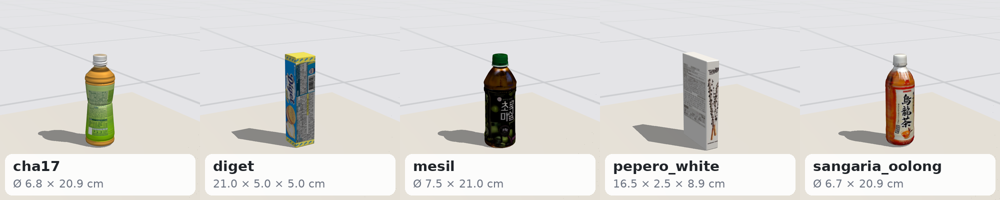
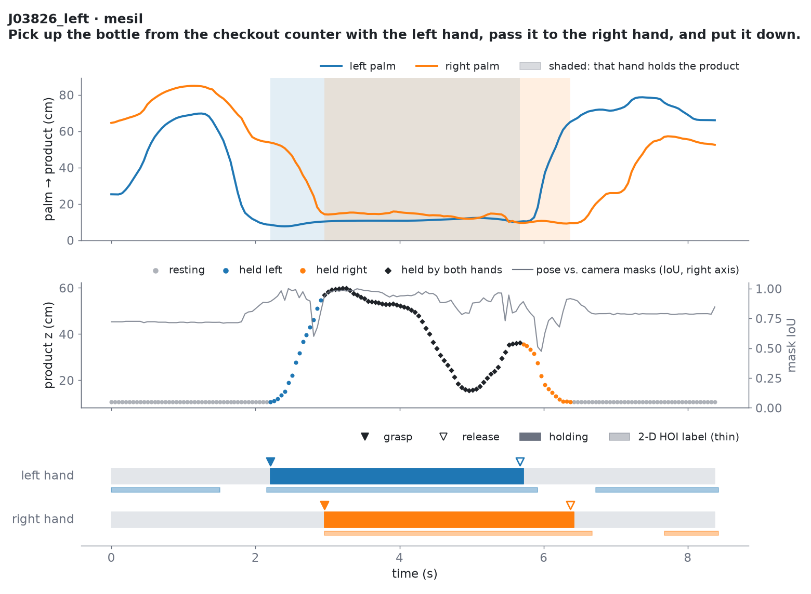
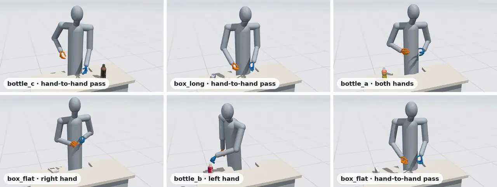

<div align="center">

# ARCADE-Checkout / human

**3-D hand–object demonstrations at a self-checkout counter, ready for robot learning.**

[](LICENSE) [](CHANGELOG.md) [](https://www.python.org/)

[](https://huggingface.co/SpaceVision-AI)


<sub>Episode `J03826_left`, rendered from the released files: the shopper's body and both 21-landmark hands
(blue left, orange right), the product's 6-DoF pose and mesh, and when each hand holds it.
Reproduce it from the in-repo sample with `arcade-human video samples/arcade_human_sample J03826_left out.mp4`.
▶ <a href="docs/media/episode_hero.mp4">MP4, 1080p</a></sub>

</div>

The human data of ARCADE-Checkout, released as **ARCADE-Checkout-Human**: one shopper picking up,
inspecting, passing between hands and putting down retail products at a self-checkout counter, as
metric 3-D data, with a Python reader, validator and renderer. It is one of the three parts of the
[ARCADE-Checkout repository](..):

* **[Overview](../README.md)**: what ARCADE is, datasheets and glossary. Start there if you are
  evaluating ARCADE.
* **`human/`** (this directory): the human data (3-D hands, body, product pose, grasp/release
  events, segmentation masks) and the code to read, check and render it.
* **[`robots/`](../robots)**: the same episodes on robots (the ROBOTIS FFW-SH5 humanoid, two
  UR10e arms and the Unitree G1 humanoid) as LeRobot datasets, and the retargeting code.

## Try it on the sample

This directory ships 2 episodes (the hand-to-hand pass above and a one-hand episode), so nothing needs downloading:

```bash
git clone https://github.com/SpaceVision-ai/ARCADE-Checkout.git && cd ARCADE-Checkout/human
pip install -e .
arcade-human info samples/arcade_human_sample
arcade-human validate samples/arcade_human_sample        # schema + physical checks: 0 errors, 0 warnings
```

```python
from arcade_human import ArcadeHuman

ds = ArcadeHuman("samples/arcade_human_sample")
ep = ds.load("J03826_left")

ep.hand_position("right")      # (168, 21, 3) metres, counter frame; NaN where invalid,
                               #   ep["hand/right/gap_filled"] marks interpolated frames
ep.wrist_pose("right")         # (168, 7)  [x, y, z, qx, qy, qz, qw]
ep.object_pose                 # (168, 7)  product pose; ep.object_vertices_world(t) places its mesh
ep["interaction/left/holding"] # (168,)    per-hand holding; both hands can hold at once
ep.events                      # [{'frame': 44, 'hand': 'left', 'kind': 'grasp', ...}, ...]
ep.task                        # 'Pick up the bottle from the checkout counter with the left hand,
                               #  pass it to the right hand, and put it down.'
```

Look at it:

```bash
pip install -e ".[render]" && arcade-human video samples/arcade_human_sample J03826_left out.mp4    # MuJoCo render (needs ffmpeg)
pip install -e ".[viz]"    && arcade-human overview samples/arcade_human_sample J03826_left card.png # episode card (matplotlib)
pip install -e ".[viewer]" && arcade-human view samples/arcade_human_sample J03826_left             # interactive 3-D (rerun)
```

<sub>On a machine without a screen, `arcade-human view` writes `J03826_left.rrd`; open it with `rerun J03826_left.rrd` anywhere.
The viewer needs `rerun-sdk` ≥ 0.28: keep it in its own environment if you also use `lerobot` 0.3.x.</sub>

## What you can use today

| | |
|---|---|
| **In this directory now** | `samples/arcade_human_sample`: 2 episodes (the hand-to-hand pass above and a one-hand episode) in the exact release format, and the reader, validator, quality summary and renderers |
| **Full release** | 97 episodes, same layout as the sample: core (`data/`, `meta/`, `objects/`) 49 MB, masks (`segmentation/`, 263,441 PNGs in one `masks.zip` per episode) 2.7 GB, on [Hugging Face](https://huggingface.co/datasets/SpaceVision-AI/ARCADE-Checkout-Human) (gated access). RGB camera video will be released after de-identification |
| **Good for** | grasp, release and hand-over timing; bimanual coordination; hand-to-product distance and approach; product 6-DoF tracking; retargeting human hands to robot hands |
| **Limits** | product mass and friction not measured |

## At a glance

| | figure | what it means |
|---|---|---|
| Episodes | **97**, one product each, 5.1 to 12.3 s at 19.94 fps | 7.2 min of unique motion: enough to study and compare methods, too small to train a general policy on its own |
| Behaviours | 49 hand-to-hand passes, 10 both-hands holds, 37 one-hand (33 right, 4 left), 1 picked up twice | half of the episodes contain a pass from one hand to the other |
| Per frame | 23 body joints, 21 landmarks per hand, wrist SE(3), product 6-DoF pose, per-hand holding and carrying | everything is in one metric counter frame, so hand-to-product distances come directly from the arrays |
| Labels | 360 grasp/release events; 263,441 segmentation masks in 3 camera views | events and holding intervals agree within one frame (358 of 360) |
| Products | 5 (three bottles, two boxes), textured meshes, measured dimensions | the product pose places its mesh in the scene, so contact and occlusion can be computed |
| Overlap | 14,802 episode frames cover 8,660 unique session frames | episodes share frames: split by time ([below](#splits-without-leakage)), never at random |

## What is in an episode

`data/human_motion.hdf5 → episodes/<episode_id>/`, with `T` frames:

| dataset | shape | meaning |
|---|---|---|
| `body/position`, `body/filled` | `T×23×3`, `T×23` | COCO-WholeBody body joints (m), fixed bone lengths; `filled` marks joints taken from the fit |
| `hand/{left,right}/position` | `T×21×3` | hand landmarks (m). `gap_filled` marks interpolated frames |
| `wrist/{left,right}/pose` | `T×7` | wrist position + quaternion (xyzw), derived from the landmarks |
| `object/pose` | `T×7` | product pose (product frame → counter frame) |
| `object/state`, `object/mask_iou` | `T` | rest / carried-left / carried-right, and the pose's agreement with the camera masks |
| `interaction/{left,right}/holding`, `.../carrying` | `T` | the hand holds the product (grasp to release); the hand the product moves with |
| `events/{frame,hand,kind}` | `E` | grasp / release instants |

Episode attributes give the product, its measured dimensions and mesh, `task_kind`
(`pass`, `both_hands`, `one_hand`, `repeated`) and the hands that pick up and put down.

Every 3-D quantity is in one **counter frame**: `x` forward across the counter, `y` the
shopper's left, `z` up, counter top at `z = 0`, metres.

How these fields give each hand's phase (before the grasp, just before it, hold, after):
[overview](../README.md#what-happens-in-an-episode).

Full specification: [docs/FORMAT.md](docs/FORMAT.md) · frames: [docs/COORDINATES.md](docs/COORDINATES.md) · how it was made: [docs/METHOD.md](docs/METHOD.md).



| product | shape | size (median) | episodes |
|---|---|---|---|
| `cha17` | bottle | Ø 6.8 × 20.9 cm | 17 |
| `diget` | box | 21.0 × 5.0 × 5.0 cm | 23 |
| `mesil` | bottle | Ø 7.5 × 21.0 cm | 24 |
| `pepero_white` | box | 16.5 × 2.5 × 8.9 cm | 18 |
| `sangaria_oolong` | bottle | Ø 6.7 × 20.9 cm | 15 |

## Quality you can check

`arcade-human quality ../data/ARCADE-Checkout-Human` computes these numbers from the files (full release shown):

| | result | what it means |
|---|---|---|
| selection | every episode passes an automatic check of physical plausibility and agreement with the camera masks | the product rests on the counter, moves with the carrying hand and matches what the cameras see ([checks](docs/METHOD.md)) |
| validator | 0 errors, 2 warnings | the files follow the format; resting products, holding hands and events are consistent ([validation](docs/FORMAT.md#validation)) |
| product pose vs. camera masks | silhouette IoU median 0.91 while held and 0.81 while resting; 98 % of frames with masks reach IoU ≥ 0.5 | the posed mesh lines up with what the cameras see. `object/mask_iou` gives the value per frame, so you can drop the frames that disagree |
| arm joints measured | shoulders 97.8 %, elbows 95.3 %, wrists 99.1 % of frames; all six at once 90.5 % | about 1 frame in 10 has an arm joint taken from the skeleton fit; `body/filled` marks it |
| hands observed (not interpolated) | 100 % of frames in the median episode (minimum 56 %) | most episodes have no interpolated hand frames; the few long gaps are flagged `gap_filled` |
| events vs. holding intervals | 358 of 360 agree within one frame | event times and holding intervals can be used interchangeably |



<sub>`arcade-human overview samples/arcade_human_sample J03826_left card.png`: palm-to-product distance (top), product height
coloured by who holds it, with the pose's agreement with the camera masks (middle), and the holding lanes with grasp/release markers (bottom).</sub>



<sub>Six episodes of the five products: passes, a both-hands hold and one-hand episodes. Each clip is resampled to 8 s.</sub>

## Splits without leakage

All episodes come from one continuous recording and overlap in time (14,802 episode frames
cover 8,660 unique frames), so random splits leak. Split by time, or hold out a product:

```python
from arcade_human.splits import time_split, product_split
time_split(ds)                    # contiguous time blocks; full release: train 74 / val 8 / test 13 (+2 boundary)
product_split(ds, "mesil")        # unseen product; train episodes that share frames with it are dropped
```

## Citation and license

* Cite via [`CITATION.cff`](../CITATION.cff) at the repository root (GitHub's "Cite this repository").
* The code and the data are released under [CC BY-NC 4.0](LICENSE) (Creative Commons
  Attribution-NonCommercial 4.0): non-commercial use with attribution. For commercial use, write to
  [contact@space-vision.ai](mailto:contact@space-vision.ai).
* The full dataset on [Hugging Face](https://huggingface.co/datasets/SpaceVision-AI/ARCADE-Checkout-Human) is under the same license.
* The license covers our measurements and annotations. The packaging artwork in the product mesh textures
  belongs to the product makers and is not licensed under CC BY-NC 4.0.

---

<sub>[Overview](../README.md) · **human** (human data) · [robots](../robots) (robot data)</sub>
