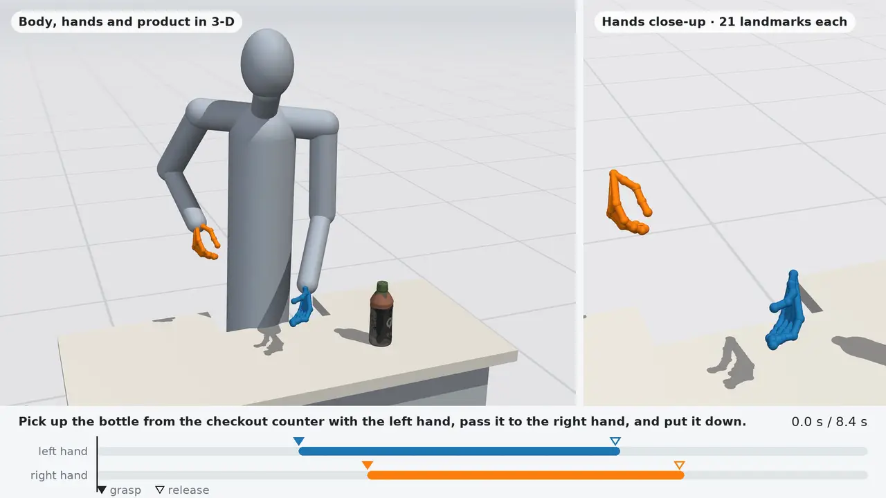

<div align="center">

# ARCADE-Checkout / human

**3-D hand–object demonstrations at a self-checkout counter, ready for robot learning.**

[](LICENSE) [](CHANGELOG.md) [](https://www.python.org/)

[](https://huggingface.co/SpaceVision-AI)



<sub>Episode `J03826_left`, rendered from the released files: the shopper's body and both 21-landmark hands
(blue left, orange right), the product's 6-DoF pose and mesh, and when each hand holds it.
Reproduce it from the in-repo sample with `arcade-human video samples/arcade_human_sample J03826_left out.mp4`.
▶ <a href="docs/media/episode_hero.mp4">MP4, 1080p</a></sub>

</div>

The human data of ARCADE-Checkout, released as **ARCADE-Checkout-Human**: one shopper picking up,
inspecting, passing between hands and putting down retail products at a self-checkout counter, as
metric 3-D data, with a Python reader, validator and renderer. It is one of the three parts of the
[ARCADE-Checkout repository](..):

* **[Overview](../README.md)**: what ARCADE is, datasheets and glossary. Start there if you are
  evaluating ARCADE.
* **`human/`** (this directory): the human data (3-D hands, body, product pose, grasp/release
  events, segmentation masks, a quality label per episode) and the code to read, check and render it.
* **[`robots/`](../robots)**: the same episodes on robots (the ROBOTIS FFW-SH5 humanoid, two
  UR10e arms and the Unitree G1 humanoid) as LeRobot datasets.

## Try it on the sample

This directory ships 4 episodes, so nothing needs downloading: three pass the automatic quality check (the
hand-to-hand pass above and two one-hand episodes), and `J06564_right` fails it and is kept as an example of a
rejected episode.

```bash
git clone https://github.com/SpaceVision-ai/ARCADE-Checkout.git && cd ARCADE-Checkout/human
pip install -e .
arcade-human info samples/arcade_human_sample
arcade-human validate samples/arcade_human_sample        # schema + physical checks: 0 errors, 0 warnings
arcade-human quality samples/arcade_human_sample         # the quality check (3 of 4 pass) and figures over the passing episodes
```

```python
from arcade_human import ArcadeHuman

ds = ArcadeHuman("samples/arcade_human_sample")
ep = ds.load("J03826_left")

ep.hand_position("right")      # (168, 21, 3) metres, counter frame; NaN where invalid,
                               #   ep["hand/right/gap_filled"] marks interpolated frames
ep.wrist_pose("right")         # (168, 7)  [x, y, z, qx, qy, qz, qw]
ep.object_pose                 # (168, 7)  product pose; ep.object_vertices_world(t) places its mesh
ep["interaction/left/holding"] # (168,)    per-hand holding; both hands can hold at once
ep.events                      # [{'frame': 44, 'hand': 'left', 'kind': 'grasp', ...}, ...]
ep.task                        # 'Pick up the bottle from the checkout counter with the left hand,
                               #  pass it to the right hand, and put it down.'
ep.check_passed                # True: the episode passes the automatic quality check
ds.passed_ids                  # the 3 passing episodes; ds.load("J06564_right").check_failed
                               #   -> ['held_product_vs_masks', 'product_vs_masks']
```

Look at it:

```bash
pip install -e ".[render]" && arcade-human video samples/arcade_human_sample J03826_left out.mp4    # MuJoCo render (needs ffmpeg)
pip install -e ".[viz]"    && arcade-human overview samples/arcade_human_sample J03826_left card.png # episode card (matplotlib)
pip install -e ".[viewer]" && arcade-human view samples/arcade_human_sample J03826_left             # interactive 3-D (rerun)
```

<sub>On a machine without a screen, `arcade-human view` writes `J03826_left.rrd`; open it with `rerun J03826_left.rrd` anywhere.
The viewer needs `rerun-sdk` ≥ 0.28: keep it in its own environment if you also use `lerobot` 0.3.x.</sub>

## What you can use today

| | |
|---|---|
| **In this directory now** | `samples/arcade_human_sample` (21 MB): 4 episodes in the exact release format, with the masks of each episode's product in 3 camera views. `J00601_right`, `J02562_right` and `J03826_left` pass the quality check; `J06564_right` fails it and is kept as an example. Plus the reader, validator, quality summary and renderers |
| **Full release** | 114 episodes (111 pass the quality check), same layout as the sample: core (`data/`, `meta/`, `objects/`) 41 MB, on [Hugging Face](https://huggingface.co/datasets/SpaceVision-AI/ARCADE-Checkout-Human) (gated access). This repository ships masks only for the sample episodes; masks for every episode are in the Hugging Face release (`segmentation/`, one `masks.zip` per episode) |
| **Not included** | RGB video is not part of the release. For recordings whose participants consented to sharing, it can be provided on request, after consultation and de-identification. Camera intrinsics and extrinsics are not released |
| **Good for** | grasp, release and hand-over timing; bimanual coordination; hand-to-product distance and approach; product 6-DoF tracking; retargeting human hands to robot hands |
| **Limits** | one shopper, one session, 5 products; no scan events; product mass and friction not measured; no independent ground truth for the 3-D poses ([what the check does not prove](docs/METHOD.md#what-the-check-does-not-prove)) |

## At a glance

| | figure | what it means |
|---|---|---|
| Episodes | **114** released, **111** pass the automatic quality check; one product each, 19.94 fps; the passing episodes last 5.0 to 13.2 s | 7.5 min of unique motion: enough to study and compare methods, too small to train a general policy on its own. Every segmented episode is released and labelled, none is filtered out |
| Behaviours (passing episodes) | 55 hand-to-hand passes, 12 both-hands holds, 43 one-hand (38 right, 5 left), 1 picked up twice | half of the episodes contain a pass from one hand to the other |
| Per frame | 23 body joints, 21 landmarks per hand, wrist SE(3), product 6-DoF pose, per-hand holding and carrying | everything is in one metric counter frame, so hand-to-product distances come directly from the arrays |
| Labels | 424 grasp/release events; segmentation masks in 3 camera views; `check_passed` and `check_failed` per episode | events and holding intervals agree within one frame (410 of 412 in the passing episodes) |
| Products | 5 (three bottles, two boxes), measured dimensions, meshes with de-identified textures | the product pose places its mesh in the scene, so contact and occlusion can be computed |
| Overlap | 17,188 episode frames cover 8,969 unique session frames | episodes share frames: split by time ([below](#splits-without-leakage)), never at random |

## What is in an episode

`data/human_motion.hdf5 → episodes/<episode_id>/`, with `T` frames:

| dataset | shape | meaning |
|---|---|---|
| `body/position`, `body/filled` | `T×23×3`, `T×23` | COCO-WholeBody body joints (m), fixed bone lengths; `filled` marks joints taken from the fit |
| `hand/{left,right}/position` | `T×21×3` | hand landmarks (m). `gap_filled` marks interpolated frames |
| `wrist/{left,right}/pose` | `T×7` | wrist position + quaternion (xyzw), derived from the landmarks |
| `object/pose` | `T×7` | product pose (product frame → counter frame) |
| `object/state`, `object/mask_iou` | `T` | rest / carried-left / carried-right, and the pose's agreement with the camera masks |
| `interaction/{left,right}/holding`, `.../carrying` | `T` | the hand holds the product (grasp to release); the hand the product moves with |
| `events/{frame,hand,kind}` | `E` | grasp / release instants |

Episode attributes give the product, its measured dimensions and mesh, `task_kind`
(`pass`, `both_hands`, `one_hand`, `repeated`), the hands that pick up and put down, and the
result of the quality check: `check_passed` and `check_failed` (the ids of the failed rules).

Every 3-D quantity is in one **counter frame**: `x` forward across the counter, `y` the
shopper's left, `z` up, counter top at `z = 0`, metres.

How these fields give each hand's phase (before the grasp, just before it, hold, after):
[overview](../README.md#what-happens-in-an-episode).

Full specification: [docs/FORMAT.md](docs/FORMAT.md) · frames: [docs/COORDINATES.md](docs/COORDINATES.md) · how it was made: [docs/METHOD.md](docs/METHOD.md).


| product | shape | size (median) |
|---|---|---|
| `bottle_a` | bottle | Ø 6.8 × 20.9 cm |
| `bottle_b` | bottle | Ø 6.7 × 20.9 cm |
| `bottle_c` | bottle | Ø 7.5 × 21.0 cm |
| `box_flat` | box | 16.5 × 2.5 × 8.9 cm |
| `box_long` | box | 21.0 × 5.0 × 5.0 cm |

The product ids are neutral and the mesh textures are de-identified: brand names, logos, codes and readable
text are replaced by colour fields and unreadable glyphs, so the textures do not match the real packaging.
Geometry and dimensions are the measured ones.

## Quality you can check

Every segmented episode of the session is released. Nothing is filtered out: an automatic check of physical
plausibility and of agreement with the camera masks labels each episode (`check_passed`, `check_failed`).
How the reconstruction is corrected and what the check tests are described in
[METHOD.md, "Corrections"](docs/METHOD.md#corrections) and [METHOD.md, "Quality check"](docs/METHOD.md#quality-check).

`arcade-human quality ../data/ARCADE-Checkout-Human` reports the check and computes the other numbers from the
files, over the passing episodes (full release shown):

| | result | what it means |
|---|---|---|
| quality check | 111 of 114 released episodes pass. Failed rules (episodes): `held_product_axis` 2, `hand_product_gap` 1, `held_product_vs_masks` 1, `product_vs_masks` 1 | in a passing episode the product rests on the counter, moves with the carrying hand and matches what the cameras see. The 3 failing episodes (`J06521_left`, `J06564_right`, `J06848_right`) stay in the release with their failed rules ([quality check](docs/METHOD.md#quality-check)) |
| validator | 0 errors, 2 warnings | the files follow the format; resting products, holding hands and events are consistent. Both warnings are on `J08189_left`: a grasp and a release event that disagree with the holding interval ([validation](docs/FORMAT.md#validation)) |
| product pose vs. camera masks | silhouette IoU median 0.90 while held and 0.80 while resting; 97.7 % of frames with masks reach IoU ≥ 0.5 | the posed mesh lines up with what the cameras see. `object/mask_iou` gives the value per frame, so you can drop the frames that disagree. It measures agreement with the masks the pose was fitted to, not accuracy against an independent reference ([limits](docs/METHOD.md#what-the-check-does-not-prove)) |
| arm joints measured | shoulders 97.7 %, elbows 95.0 %, wrists 99.1 % of frames; all six at once 90.0 % | 1 frame in 10 has an arm joint taken from the skeleton fit; `body/filled` marks it |
| hands observed (not interpolated) | 100 % of frames in the median episode and hand (minimum 56 %) | most episodes have no interpolated hand frames; the few long gaps are flagged `gap_filled` |
| events vs. holding intervals | 410 of 412 agree within one frame | event times and holding intervals can be used interchangeably |


<sub>`arcade-human overview samples/arcade_human_sample J03826_left card.png`: palm-to-product distance (top), product height
coloured by who holds it, with the pose's agreement with the camera masks (middle), and the holding lanes with grasp/release markers (bottom).</sub>


<sub>Six episodes of the five products: passes, a both-hands hold and one-hand episodes. Each clip is resampled to 8 s.</sub>

## Splits without leakage

All episodes come from one continuous recording and overlap in time (17,188 episode frames
cover 8,969 unique frames), so random splits leak. Split by time, or hold out a product:

```python
from arcade_human.splits import time_split, product_split
time_split(ds)                    # contiguous time blocks: passing episodes go to 'train', 'val' or 'test';
                                  #   also 'boundary' (straddle a block edge) and 'rejected' (fail the check)
product_split(ds, "bottle_c")     # unseen product; train episodes that share frames with it are dropped
```

`time_split` uses only the episodes that pass the quality check and lists the others under `rejected`.
`product_split` does the same.

## Citation and license

* Cite via [`CITATION.cff`](../CITATION.cff) at the repository root (GitHub's "Cite this repository").
* The code and the data are released under [CC BY-NC 4.0](LICENSE) (Creative Commons
  Attribution-NonCommercial 4.0): non-commercial use with attribution. For commercial use, write to
  [contact@space-vision.ai](mailto:contact@space-vision.ai).
* The full dataset on [Hugging Face](https://huggingface.co/datasets/SpaceVision-AI/ARCADE-Checkout-Human) is under the same license.
* The product mesh textures are de-identified: brand names, logos, codes and readable text are replaced by
  colour fields and unreadable glyphs.

---

<sub>[Overview](../README.md) · **human** (human data) · [robots](../robots) (robot data)</sub>
