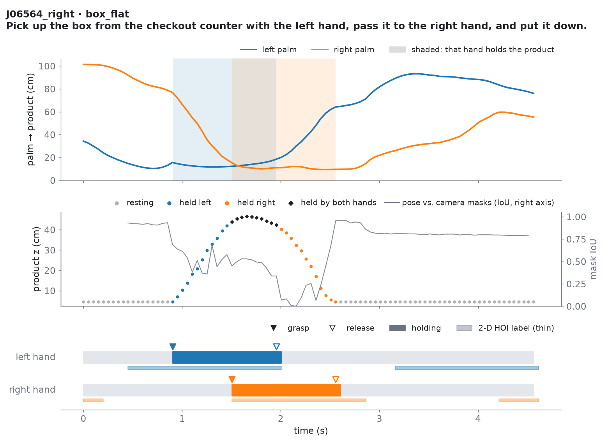
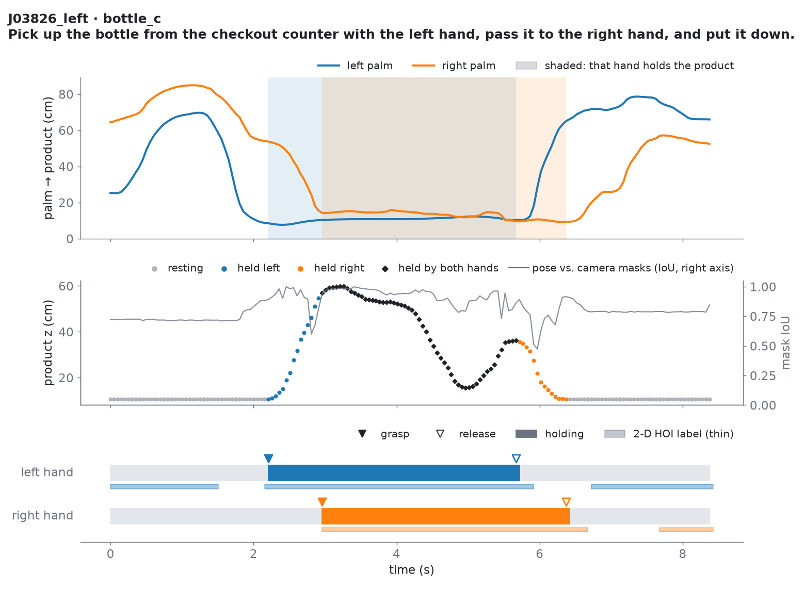
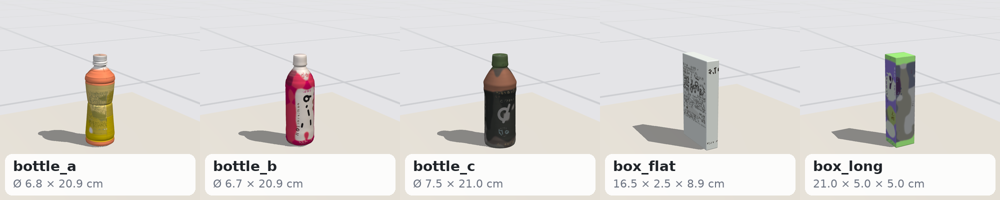

# How the data was produced

This page describes how the released data was created. **The generation pipeline itself, and
the models it runs, are not part of this repository.** This repository only reads, validates
and visualises the released data.

## Capture

* **Setting:** one self-checkout counter in a lab. A shopper picks products up from the
  counter, inspects them, sometimes hands them from one hand to the other, and puts them
  down.
* **Cameras:**
  * two side cameras (`left`, `right`), fisheye lenses;
  * one top-down camera (`top`);
  * one front camera (`front`), used for pose reconstruction only.
* **Frame rate:** about 19.94 fps, software-synchronised.
* **Calibration:** ChArUco board, camera intrinsics plus multi-view extrinsics. The camera
  intrinsics and extrinsics are not released.
* **Session:** `capture_20260818_01`, about 9 minutes of continuous recording, one shopper.
  The 114 released episodes cover 7.5 minutes.
* **RGB video** is not part of the release. For recordings whose participants consented to
  sharing, it can be provided on request, after consultation and de-identification.

## 2-D labels (per camera, whole session)

1. **Hand-object interaction (HOI).** A fused HOI and segmentation detector runs on the
   `left`, `right` and `top` views. A hand is "holding" in a view when the detector links
   it to an object near the projected 3-D wrist. The fused label requires 2 of 3 views and
   uses hysteresis. Released as `interaction/*/hoi_holding`.
2. **Object segmentation and tracking.** Product instances are segmented per view and
   tracked through the session.
3. **Grasp and release events.** Rules on the object tracks (which hand an object moves with)
   and the HOI signal give grasp and release instants per hand. These labels are automatic.

## 3-D motion, episodes and products

1. **3-D body and hands.** 2-D whole-body keypoints (133 points) from all four views are
   triangulated with the rig calibration.
2. **Body fit.** A body skeleton with bone lengths fixed for the whole session is fitted to the
   triangulated joints, so limbs keep their length and do not jump. Joints the cameras did not
   see are filled from the fit and flagged `body/filled`. The body's wrist is the hand's root.
3. **Hand fit.** A hand rig (wrist pose plus 21 finger joint angles) is fitted to the 2-D hand
   keypoints as a sequence, and short gaps are filled in joint-angle space (`gap_filled`).
4. **Episodes.** The session is cut into one episode per product handled, from the grasp/release
   events and per-hand holding intervals. Each episode gets a lead-in and a tail of context
   frames. Every segmented episode is released.
5. **Segmentation masks.** Per-episode object masks are associated across views into
   instances, and the instance that is the episode's product is identified per frame
   (`segmentation/*/instances.json`).
6. **Product recognition.** Each episode's product is matched against the 5-product
   catalogue from the product masks, using colour and image-embedding similarity. Released
   in the episode attribute `recognition`.
7. **Product 6-DoF.** Each episode is fitted as a whole, as a sequence of contact modes: in
   every frame the product either rests on the counter or is carried by one hand.
   * **Resting phase:** one pose for the whole phase, on a stable face of the product, chosen
     by the multi-view mask evidence of all its frames (`object/source` `rest_<k>`).
   * **Carried phase:** the product follows the palm of the carrying hand, with a hand-relative
     pose that changes only slowly, fitted to the masks (`held_<hand>`). While both hands hold
     it, it is kept between them.
   * **Grasp, release and hand-over instants:** near each labelled event, the frame where the
     hand touches the product and the masks agree best. These instants give
     `interaction/*/carrying` and `object/state`. `interaction/*/holding` keeps the labelled
     grasp-to-release intervals, so during a hand-over both hands hold but only one carries.
   * The agreement of the posed product with the masks is kept per frame as
     `object/mask_iou`.
8. **Corrections.** The hand and product motion is corrected with the same steps for every
   episode ([Corrections](#corrections)).
9. **Quality check.** Every episode is checked with the same rules and labelled
   ([Quality check](#quality-check)).
10. **Frame.** All of the above is expressed in the counter frame
    ([COORDINATES.md](COORDINATES.md)).

## Corrections

The reconstruction is corrected by the steps below. They are the same for every episode.

1. **The carried product is tied to the carrying hand.** While it is carried, the product keeps
   a hand-relative pose that changes only slowly. The camera masks are weak evidence: they can
   pull this pose, but they do not override the hand.
2. **Junction correction** (new in 1.1.0). At every transition between resting and carried, and
   at every hand-over, a jump of the product relative to the palm (more than 4 cm or 20°)
   within 10 frames of the transition is removed: those frames are carried again from the first
   settled frame, and the resting pose is settled again on the nearest stable face.
3. **Off-hand attachment.** A hand that the cameras lose while both hands hold the product is
   attached to the product. These frames are flagged `gap_filled`.
4. **Fingers and smoothing.** Fingers are pushed off the product surfaces, and the hand motion
   is smoothed on the hand rig, so bone lengths stay fixed.
5. **Check scope** (new in 1.1.0). This step changes the check, not the data: the rules that
   compare the carried product with its masks are evaluated only where the cameras see the
   product well ([Quality check](#quality-check)).

## Quality check

Every segmented episode of the session is released. Nothing is filtered out: an automatic check
labels each episode with `check_passed` and `check_failed`, the list of the rule ids it fails
(empty when it passes). The labels are in the episode attributes and in `meta/episodes.jsonl`;
the rule ids and their descriptions are in `meta/info.json -> check_rules` and in
`arcade_human.schema.CHECK_RULES`. The time splits use only the passing episodes and list the
others as `rejected` ([FORMAT.md](FORMAT.md#episode-overlap)).

An episode fails a rule when:

| group | rule id | an episode fails it when | where it is evaluated |
|---|---|---|---|
| physical plausibility | `product_below_counter` | the product is below the counter top | everywhere |
| | `product_floating` | a resting product is not on the counter, or a carried product is away from the carrying hand | everywhere |
| | `resting_product_moves` | a resting product moves, tilts, stands upside down or is not on a stable face | everywhere |
| | `product_leaves_hand` | the carried product leaves the palm of the carrying hand | everywhere |
| | `product_slips_in_hand` | the carried product jumps in the hand from one frame to the next | everywhere |
| | `hand_product_gap` | a gap between hand and product at a grasp or a release | everywhere |
| | `product_jumps` | the product jumps between frames | everywhere |
| | `hand_in_product` | the hand is inside the product while carrying it | everywhere |
| | `product_pose_missing` | the product pose is unknown in too many frames | everywhere |
| agreement with the camera masks | `product_vs_masks` | the posed product disagrees with its camera masks over the episode or over a run of frames | the whole episode |
| | `held_product_vs_masks` | while carried well above the counter, the posed product disagrees with its camera masks | only while the product is carried at least 10 cm above the surface it was picked from, and at least 8 frames away from grasp and release |
| | `held_product_axis` | while carried well above the counter, the long axis of the posed product disagrees with its masks | the same |

All rules use fixed thresholds, the same for every episode. The two rules for the carried
product are limited to the frames where the cameras see it well, because near the counter the
hands and the other products hide it. The physical rules apply everywhere.

The 4 cm / 20° limit of the junction correction is part of a correction
([Corrections](#corrections), step 2), not a rule of the check.

### Result

111 of the 114 released episodes pass. The 3 others stay in the release with their failed rules:

| episode | failed rules |
|---|---|
| `J06521_left` | `hand_product_gap`, `held_product_axis` |
| `J06564_right` | `held_product_vs_masks`, `product_vs_masks` |
| `J06848_right` | `held_product_axis` |

`J06564_right` is in the in-repo sample as an example of a rejected episode.

Release 1.0.0 held only the episodes that passed its check: 97. With the same recordings,
111 episodes pass in 1.1.0. The difference comes mainly from the check scope: in 1.0.0 the
mask rules were applied to every carried frame, including the frames near the counter where
hands and other products hide the product. The junction correction changed the resting pose
of 5 episodes in this session.

`arcade-human overview samples/arcade_human_sample J06564_right card.png`: the rejected sample episode.
The grey line (pose vs. camera masks) falls to zero while the product is carried, which is what the
`product_vs_masks` and `held_product_vs_masks` rules catch.

`arcade-human quality RELEASE` reports the check and computes the figures of the
[README](../README.md#quality-you-can-check) over the passing episodes.

The card shows, for episode `J03826_left`, the per-frame agreement of the posed product with
its masks (`object/mask_iou`) next to the holding intervals. The evidence images and videos,
and the commands that render them from the released files, are listed in
[media/README.md](media/README.md).

### What the check does not prove

* **Self-consistency, not accuracy.** The silhouette IoU measures how well the posed product
  agrees with the masks the pose was fitted to. It is not an accuracy against an independent
  ground truth: no motion-capture reference exists.
* **In-hand rotation is under-represented.** The carried product pose is constrained by the
  hand, so rotation of the product inside the hand is under-represented.
* **One shopper, one session, 5 products.**
* **No scan events.**

## Products

There are 5 retail products: three cylindrical bottles (`bottle_a`, `bottle_b`, `bottle_c`)
and two boxes (`box_flat`, `box_long`). Meshes are approximate shapes: the bottles are surfaces of
revolution and the boxes are boxes, with the outline and dimensions the data was made with. The
textures are de-identified: brand names, logos, codes and readable text are replaced by colour
fields and unreadable glyphs, so they do not match the real packaging. Mass and friction were not
measured.

## Observed and derived values

Use the `valid`, `body/filled` and `gap_filled` flags to separate observed from derived body and hand
values, `object/mask_iou` to judge each frame's product pose, and `check_passed` / `check_failed` to
select episodes.

## Version

Release 1.1.0, processed 2026-11-25 (recorded in `meta/info.json -> provenance`).
