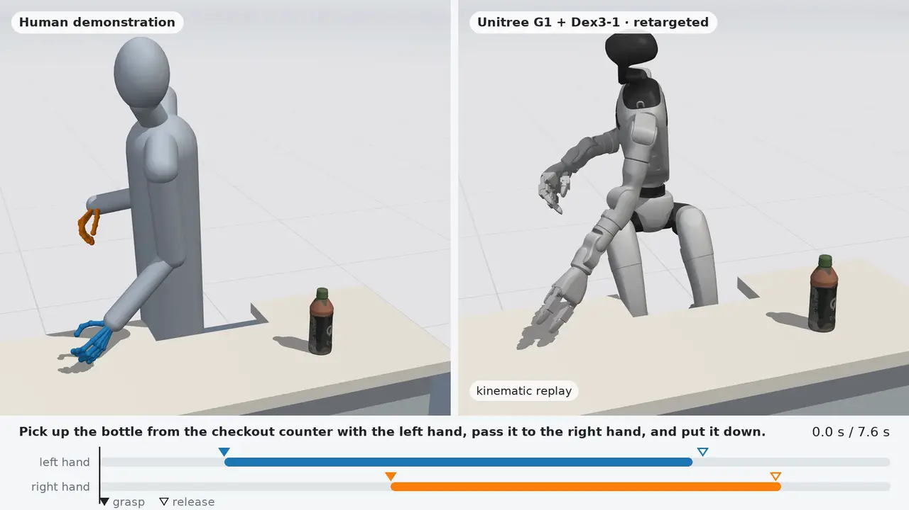

<div align="center">

# ARCADE-Checkout / robots

**Human checkout demonstrations retargeted to robots, as state-only LeRobot datasets: the ROBOTIS AI Worker (FFW-SH5), two UR10e arms with Robotiq 2F-140 grippers, and the Unitree G1 humanoid with Dex3-1 hands.**

[](LICENSE) [](CHANGELOG.md) [](https://www.python.org/) [](https://github.com/huggingface/lerobot)

[](https://huggingface.co/SpaceVision-AI)


<sub>Episode `J03826_left`. Left: the recorded human demonstration. Right: the same episode on the ROBOTIS FFW-SH5,
replayed from the released joint trajectories (kinematic, no physics). On the timeline, bars show when each hand holds the
product, triangles the grasp and release events, and the grey bands where the robot blends from and to its home pose. ▶ <a href="docs/media/human_vs_robot.mp4">MP4, 1080p, two episodes</a></sub>

</div>

The robot data of ARCADE-Checkout, released as **ARCADE-Checkout-FFW-SH5**,
**ARCADE-Checkout-UR10e** and **ARCADE-Checkout-G1**: the recorded checkout demonstrations
retargeted to three robots, as state-only LeRobot datasets, with the code that exports and checks
them. It is one of the three
parts of the [ARCADE-Checkout repository](..):

* **[Overview](../README.md)**: what ARCADE is, datasheets and glossary. Start there if you are
  evaluating ARCADE.
* **[`human/`](../human)**: the human data (3-D hands, body, product pose, grasp/release
  events, segmentation masks) of the same recording session.
* **`robots/`** (this directory): the robot versions as LeRobot datasets, the
  LeRobot exporter, the robot description fetchers and a preview renderer.

| robot | `robot_type` | state / action | episodes released | pass the robot-side check | sample |
|---|---|---|---|---|---|
| ROBOTIS AI Worker FFW-SH5: swerve base, lift, 2 × 7-DoF arms, 2 × 20-joint hands, 2-DoF head | `ffw_sh5_rev1` | 60-D | 111 | 83 | `samples/lerobot_ffw_sh5_v3.0` |
| two Universal Robots UR10e arms with Robotiq 2F-140 grippers, fixed bases ([details](#two-ur10e--robotiq-2f-140)) | `ur10e_2f140_dual` | 14-D | 110 | 67 | `samples/lerobot_ur10e_2f140_v3.0` |
| Unitree G1 humanoid (29 body joints, free-floating pelvis) with Dex3-1 three-finger hands, standing on a 0.35 m step ([details](#unitree-g1--dex3-1)) | `unitree_g1_dex3` | 50-D | 111 | 98 | `samples/lerobot_g1_dex3_v3.0` |

All three datasets are built from one human reconstruction, the ARCADE-Checkout-Human 1.1.0 release:
the same episodes, hand and product poses, holding labels and counter. Every episode is released.
None is filtered out: an automatic robot-side check labels each episode (`check_passed`, and
`check_failed` with the ids of the rules it fails). The `train`, `val` and `test` splits hold only
passing episodes; the others are listed in the `rejected` split. 49 episodes pass the check on all
three robots.

## Load the sample with LeRobot

This directory ships the same 3 episodes for every robot (`J02562_right`, `J03826_left`,
`J00601_right`) in both layouts. On FFW-SH5 and G1 the first two pass the robot-side check and
`J00601_right` is rejected; on UR10e only `J02562_right` passes. The rejected episodes are kept as
examples, after the passing ones, in the `rejected` split.

```bash
git clone https://github.com/SpaceVision-ai/ARCADE-Checkout.git && cd ARCADE-Checkout/robots
pip install "lerobot[dataset]"          # lerobot >= 0.4 reads codebase v3.0
```

```python
import json
from lerobot.datasets.lerobot_dataset import LeRobotDataset

def passing(root):
    """Episode indices of the train split: episodes that pass the robot-side check."""
    a, b = json.load(open(f"{root}/meta/info.json"))["splits"]["train"].split(":")
    return list(range(int(a), int(b)))

root = "samples/lerobot_ffw_sh5_v3.0"
ds = LeRobotDataset("local/arcade_ffw_sh5", root=root, episodes=passing(root))    # episodes 0 and 1
frame = ds[300]
frame["observation.state"].shape          # torch.Size([60])   joint positions (names in ds.meta.features)
frame["observation.environment_state"]    # product pose [x y z qx qy qz qw] + left_holding, right_holding
frame["task"]                             # 'Pick up the bottle from the checkout counter with the left hand, pass it to the right hand, ...'

root = "samples/lerobot_ur10e_2f140_v3.0"
ur = LeRobotDataset("local/arcade_ur10e_2f140", root=root, episodes=passing(root))    # episode 0
ur[300]["observation.state"].shape        # torch.Size([14])   2 x 6 arm joints + 2 gripper finger_joint

root = "samples/lerobot_g1_dex3_v3.0"
g1 = LeRobotDataset("local/arcade_g1_dex3", root=root, episodes=passing(root))        # episodes 0 and 1
g1[100]["observation.state"].shape        # torch.Size([50])   43 joints (legs, waist, arms, hands) + pelvis pose

root = "samples/lerobot_ffw_sh5_v3.0"
chunks = LeRobotDataset("local/arcade_ffw_sh5", root=root, episodes=passing(root),
                        delta_timestamps={"action": [i / ds.fps for i in range(16)]})
chunks[300]["action"].shape               # torch.Size([16, 60])  an action chunk
```

Without `episodes=`, `LeRobotDataset` loads every episode, the rejected ones included. The same
selection is in the episodes metadata, as `check_passed` per episode (with `check_failed`, the ids
of the failed rules):

```python
import pyarrow.parquet as pq
ep = pq.read_table("samples/lerobot_ffw_sh5_v3.0/meta/episodes/chunk-000/file-000.parquet").to_pydict()
[i for i, ok in zip(ep["episode_index"], ep["check_passed"]) if ok]      # [0, 1]
ep["check_failed"]                                                        # [[], [], ['idle_hand']]
```

<details><summary>lerobot 0.3.x (codebase v2.1), GR00T-style tooling</summary>

```bash
pip install "lerobot==0.3.3"
```
```python
ds = LeRobotDataset("local/arcade_ffw_sh5", root="samples/lerobot_ffw_sh5_v2.1")
```
`meta/modality.json` maps the 60-D vector and the product state to named groups, and
`meta/episodes.jsonl` holds `check_passed` and `check_failed` per episode.
</details>

<details><summary>Phases of an episode: before the grasp, hold, after</summary>

Each hand is in one of four phases at every step ([definition](../README.md#what-happens-in-an-episode)).
In the robot data they follow from `source_frame` and the two holding flags at the end of
`observation.environment_state`:

```python
import numpy as np, pyarrow.parquet as pq
t = pq.read_table("samples/lerobot_ffw_sh5_v3.0/data/chunk-000/file-000.parquet")
episode = np.array(t.column("episode_index").to_pylist())
frame = np.array(t.column("source_frame").to_pylist())                                    # session frame of each step
holding = np.array(t.column("observation.environment_state").to_pylist())[:, 7:9] > 0    # left, right

def phases(frame, holding, fade=6):
    """Per-hand phase of each step: 0 before the grasp, 1 just before it, 2 hold, 3 after."""
    g = frame[holding.any(1)].min()                      # the episode's first grasp (session frame)
    ph = np.where(frame < g - fade, 0, np.where(frame < g, 1, 3))[:, None].repeat(2, 1)
    ph[holding] = 2
    return ph                                            # (steps, 2): left, right

ph = phases(frame[episode == 1], holding[episode == 1])  # J03826_left, left hand: 0 steps 0-61, 1 62-68, 2 69-159, 3 160-330
```
The steps in which both hands are in phase 2 are the hand-over (here the right hand holds from
step 84, so both hold during steps 84–159). The home transitions are in the raw outputs
(`<hand>__w`, `<hand>__win`, [docs/FORMAT.md](docs/FORMAT.md)).
</details>

<details><summary>Without LeRobot: plain parquet</summary>

```python
import json, numpy as np, pyarrow.parquet as pq
root = "samples/lerobot_ffw_sh5_v3.0"
info = json.load(open(f"{root}/meta/info.json"))
names = info["features"]["observation.state"]["names"]
t = pq.read_table(f"{root}/data/chunk-000/file-000.parquet")
state = np.array(t.column("observation.state").to_pylist())     # (847, 60), columns = names
episode = np.array(t.column("episode_index").to_pylist())
a, b = map(int, info["splits"]["train"].split(":"))             # "0:2": the passing episodes
state[(episode >= a) & (episode < b)]                           # (566, 60)
```
</details>

## Train a policy

The stock LeRobot trainer runs on the data as is. A smoke test on the sample (CPU, a few minutes):

```bash
pip install "lerobot[training,diffusion]"
lerobot-train --dataset.repo_id=local/arcade_ffw_sh5 --dataset.root=samples/lerobot_ffw_sh5_v3.0 \
    --policy.type=diffusion --policy.push_to_hub=false --policy.device=cpu \
    --steps=20 --batch_size=8 --save_checkpoint=false --output_dir=outputs/smoke
```

<sub>Checked with `lerobot` 0.7.0 (v3.0 sample) and, as `python -m lerobot.scripts.train`, with `lerobot` 0.3.3 (v2.1 sample):
the data loads, the policy builds and the 20 steps run. The same command runs on the UR10e sample
(`--dataset.repo_id=local/arcade_ur10e_2f140 --dataset.root=samples/lerobot_ur10e_2f140_v3.0`) and on the G1 sample
(`--dataset.repo_id=local/arcade_g1_dex3 --dataset.root=samples/lerobot_g1_dex3_v3.0`), both checked with `lerobot` 0.7.0.
As written, the smoke test reads every episode of the sample, the rejected ones included. For real training, use the full datasets on Hugging Face ([FFW-SH5](https://huggingface.co/datasets/SpaceVision-AI/ARCADE-Checkout-FFW-SH5), [UR10e](https://huggingface.co/datasets/SpaceVision-AI/ARCADE-Checkout-UR10e), [G1](https://huggingface.co/datasets/SpaceVision-AI/ARCADE-Checkout-G1))
and select the episodes of the `train` split (`meta/info.json -> splits`), which holds only episodes that pass the robot-side check.</sub>

## What you can use today

| | |
|---|---|
| **In this directory now** | `samples/`: the same 3 episodes for every robot (`J02562_right`, `J03826_left`, `J00601_right`), each in LeRobot v3.0 and v2.1 plus the raw outputs. `J00601_right` is rejected on all three robots (FFW-SH5: `idle_hand`; UR10e: `gripper_contact`, `product_shift`; G1: `hand_in_product`), and UR10e also rejects `J03826_left` (`arm_self_contact`). Also the exporter, the renderer and the robot description fetchers |
| **Full dataset** | FFW-SH5: 111 episodes (83 pass), 27,024 steps, LeRobot 14 MB (v3.0) / 18 MB (v2.1), raw outputs 12 MB. UR10e: 110 episodes (67 pass), 96,040 steps, LeRobot 13 MB (v3.0) / 16 MB (v2.1), raw outputs 13 MB. G1: 111 episodes (98 pass), 14,104 steps, LeRobot 8 MB (v3.0) / 10 MB (v2.1), raw outputs 5 MB. On Hugging Face, gated access: [ARCADE-Checkout-FFW-SH5](https://huggingface.co/datasets/SpaceVision-AI/ARCADE-Checkout-FFW-SH5), [ARCADE-Checkout-UR10e](https://huggingface.co/datasets/SpaceVision-AI/ARCADE-Checkout-UR10e), [ARCADE-Checkout-G1](https://huggingface.co/datasets/SpaceVision-AI/ARCADE-Checkout-G1) |
| **Good for** | prototyping and evaluating state-based policies for a mobile bimanual humanoid with dexterous hands, two industrial arms with parallel grippers, or a whole-body humanoid with three-finger hands (the stock LeRobot trainer runs on all three as is); language-conditioned variants of one task family; retargeting research, including on the episodes a robot fails (the `rejected` split names the failed rules) |
| **Limits** | the trajectories are kinematic: no physics validation is part of this release, and they were not executed on a robot ([Hands and grippers](#hands-and-grippers)) · one shopper, one session, 5 products · product mass and friction are not measured · the G1 stands on a 0.35 m step ([G1](#unitree-g1--dex3-1)) |

## Hands and grippers

The three robots hold the product in different ways, and the data differs accordingly:

| | FFW-SH5 | two UR10e | G1 |
|---|---|---|---|
| end effector | 20-joint five-finger hands | parallel-jaw grippers | three-finger hands |
| what follows the human | hand pose and finger shape, frame by frame; fingers solved onto the product while holding | nothing frame by frame: a grasp is planned per hold on the product, the arm tracks the product | approach follows the fingertips; a grasp is planned per hold near the human grasp |
| product pose in the data | attached to the robot hand while carried (5 or more steps in a row more than 30 mm from the human path reject the episode) | moves only while a gripper holds it; may shift up to 50 mm from the human path | the human path, lightly smoothed while held |
| timing | slowed where the arm cannot follow | re-timed to joint velocity/acceleration limits (slowest) | human timing, slowed around hand-over grabs |
| body | mobile base moves, lift fixed | fixed bases | feet fixed, on a 0.35 m step |

A gripper or a three-finger hand holds with one opposed pinch that can be planned on the product's
box or cylinder. A five-finger hand that follows a human hand reproduces how the person wrapped the
product, finger by finger, and the contact is distributed over many small pads; whether that grasp
holds depends on finger compliance, friction and millimetre-level finger placement, which a
kinematic retargeting does not determine. Physics validation is not part of this release;
it will be published for all three robots together in a later release.

In all three datasets `observation.environment_state` has the same meaning: the product pose (7-D),
then `left_holding` and `right_holding`, which are 1 while that robot hand, arm or gripper holds
the product. Both are 1 during a hand-over.

## At a glance: FFW-SH5

| | figure | what it means |
|---|---|---|
| Robot | ROBOTIS AI Worker FFW-SH5 (`robot_type` `ffw_sh5_rev1`): swerve base, lift, 2 × 7-DoF arms, 2 × HX5-D20 hands (20 joints each), 2-DoF head. Description fetched from [`ROBOTIS-GIT/ai_worker@9bc7f7b`](retarget/robotis_ffw_sh5/README.md) | the upstream robot model, not redistributed here |
| Episodes | **111 released, 83 pass** the robot-side check; 27,024 steps at 20 fps (18,954 in the passing episodes); 151 / 230 / 432 steps per episode (min / median / max) | the released episodes are the ARCADE-Checkout-Human episodes that pass the human check: 55 hand-to-hand passes, 12 both-hands holds, 43 one-hand, 1 picked up twice |
| State and action | `observation.state` / `action`: 60-D joint positions. `arm_l` 0–6 · `arm_r` 7–13 · `finger_l` 14–33 · `finger_r` 34–53 · `head` 54–55 · `lift` 56 · `base x, y, yaw` 57–59 ([table](docs/FORMAT.md#state-and-action-layout-60-d)) | the action is the next state: position targets, the usual setup for action-chunking policies |
| Product state | `observation.environment_state`: product pose (7-D) + `left_holding`, `right_holding` (2-D; both 1 during a hand-over) | a state-based policy knows where the product is without a camera |
| Tasks | 12 hand-specific language tasks, one per episode (11 among the passing episodes) | e.g. *"Pick up the bottle … with the left hand, pass it to the right hand, and put it down."* |
| Speed | the timeline is slowed where the arm cannot follow | `source_frame` maps each step to its human frame |
| Links to the human data | `source_frame` per step, `source_episode_id` per episode | any step can be traced back to the ARCADE-Checkout-Human frame it was made from |
| Splits | time blocks over the passing episodes: train 61 / val 10 / test 9 (+3 boundary); rejected 28 | no session frame is shared between train, val and test; random splits would leak, because episodes overlap in time |

## Quality: FFW-SH5

| | result | what it means |
|---|---|---|
| robot-side check | 83 of the 111 released episodes pass an automatic check of the robot motion: finger self-collision and finger speed, a hand in the product before the grasp or after the release, a hand below the counter top, overlapping hands, an idle hand touching the working one, arm-branch flips, a grasp whose fingers do not reach the product surface, the carried product leaving the hand or the human product path | `check_passed` per episode; the passing episodes have none of these failures ([rules](docs/RETARGETING_FFW_SH5.md#robot-side-check)) |
| failed rules | `product_path` 16, `arm_branch` 7, `hand_overlap` 7, `idle_hand` 3, `touch_after_release` 2, `grasp_contact` 1 (episodes; an episode can fail several) | `check_failed` per episode lists them; the 28 failing episodes are the `rejected` split |
| product | attached to the robot hand while carried; a passing episode has no run of 5 or more steps in which it is more than 30 mm from the human product path | the product does not move inside the robot hand, and it travels much as it did with the shopper |
| joint limits | `tests/test_retarget_sample.py` checks on the sample that every arm joint value is within the URDF limits | |
| robot model | the links of the MuJoCo model used for the preview video agree with the URDF to 0.0001 mm over 1,000 random configurations | the preview video shows the same kinematics as the data |

Step counts and the check in detail: [docs/RETARGETING_FFW_SH5.md](docs/RETARGETING_FFW_SH5.md#figures).

## How it was retargeted: FFW-SH5

No learned model is involved: the robot hands are fitted to the human hands, the fingers are solved
onto the product for every hold, and a whole-body differential IK solves the arms and the swerve
base. The solver is not part of this repository; the exporter and the renderer work on the released
raw outputs:

```bash
pip install -e ../human -e ".[render]"
bash retarget/robotis_ffw_sh5/fetch_robot.sh                       # ROBOTIS URDF + meshes + MJCF at the pinned commit
python -m arcade_retarget.export_lerobot --retarget samples/ffw_sh5_sample/ffw_sh5 --release ../human/samples/arcade_human_sample \
    --out build/lerobot_ffw_sh5                          # LeRobot v2.1 with the time splits; docs/FORMAT.md converts to v3.0
python -m arcade_retarget.render         --release ../human/samples/arcade_human_sample --retarget samples/ffw_sh5_sample/ffw_sh5 \
    --episodes J03826_left --out build/preview.mp4       # the video above (needs ffmpeg)
```

Pass `--release` to the exporter: it gives the time splits and the task sentences of the human data.
Without it every episode goes to the `train` split, and the exporter warns.

How it works:

1. **Window.** The robot follows the shopper from shortly before the first grasp to shortly after the
   last release. Before and after, it moves from and back to a home pose.
2. **Hands.** Each frame, the robot hand pose and its 20 finger joints are fitted to the human hand
   (fingertip positions first, then finger and palm directions) within the joint limits and without
   finger self-collision.
3. **Grasp.** During a hold the fingers are solved onto the product surface, the thumb opposite the
   fingers, starting from the human finger pose. While the product is carried the hand keeps that
   grasp, so the product does not move inside the robot hand.
4. **Release.** At a release the fingers peel off the product and the hand lifts away before it
   retreats.
5. **Clearance.** Before the first grasp and after the last release the wrist path is shifted so the
   hand clears the product and the counter. An idle hand moves toward a rest pose beside the body when
   the working hand comes close.
6. **Whole-body differential IK** for the swerve base and both arms, keeping the arms clear of the
   torso, the counter edge and each other; the lift stays fixed. Where the arm cannot follow at the
   shopper's speed, the timeline is slowed.
7. **Finish.** The head camera aims at the working hand, and the carried product is attached to the
   robot hand. After a release it settles onto a stable face.

Details: [docs/RETARGETING_FFW_SH5.md](docs/RETARGETING_FFW_SH5.md) · formats: [docs/FORMAT.md](docs/FORMAT.md).

## Two UR10e + Robotiq 2F-140

The dataset is made with two UR10e arms, one to the left and one to the right of the shopper's
position. It holds 110 episodes; in 65 of them both arms handle the product (a hand-over or a
both-arm hold) and in 45 one arm does everything.

The cell is fixed: two Universal Robots UR10e arms with Robotiq 2F-140 parallel grippers, on
pedestals at counter-top height on the shopper's side of the counter. The motion is planned around
grasps: for every interval in which the shopper holds the product, a parallel-jaw grasp is planned
on the product, and the arms move to it, carry the product and hand it over
([method](docs/RETARGETING_UR10E.md)). The robot descriptions come from Universal Robots and
ROS-Industrial at fixed commits ([retarget/universal_robots_ur10e_robotiq_2f140](retarget/universal_robots_ur10e_robotiq_2f140/README.md)).


<sub>Episode `J02562_right`, at 2× speed. Left: the recorded human demonstration. Right: the two UR10e arms replaying the
released joint trajectories (kinematic, no physics). On the timeline, bars show when each gripper holds the product and
triangles the shopper's grasp and release events. ▶ <a href="docs/media/ur10e_human_vs_robot.mp4">MP4, 1080p, two episodes</a></sub>

| | figure | what it means |
|---|---|---|
| Robot | 2 × UR10e (6 joints) + 2 × 2F-140 (`finger_joint`), `robot_type` `ur10e_2f140_dual`; bases fixed 1.0 m apart | `meta/arcade.json` holds the base poses and the gripper mount |
| Episodes | **110 released, 67 pass** the robot-side check ([rules](docs/RETARGETING_UR10E.md#robot-side-check)); 96,040 steps at 20 fps (54,678 in the passing episodes); 478 / 828 / 1,625 steps per episode (min / median / max) | the ARCADE-Checkout-Human episodes that pass the human check, except `J06112_left`, which has no UR10e trajectory. Among the 67 passing episodes, both arms handle the product in 32 and one arm does everything in 35 |
| Task kinds | from the robot's own grasps: 60 `pass`, 45 `one_arm`, 5 `both_arms` (passing: 29 / 35 / 3) | the robot may pass a product the shopper handled with one hand, as in the video above |
| State and action | 14-D: `left_*` arm joints 0–5 · `right_*` 6–11 · `left_finger_joint` 12 · `right_finger_joint` 13 ([table](docs/FORMAT.md#two-ur10e--robotiq-2f-140)) | joint names match the URDF built by `retarget/universal_robots_ur10e_robotiq_2f140/fetch_robot.sh` |
| Product state | product pose (7-D) + `left_holding`, `right_holding`: the gripper is closed on the product (2-D; both 1 during a hand-over) | same layout and meaning as the other robots |
| Tasks | 11 arm-specific language tasks from the robot's own grasps (9 among the passing episodes) | e.g. *"Pick up the box … with the left arm, pass it to the right arm, and put it down."* |
| Speed | re-timed to joint velocity and acceleration limits: the slowest of the three robots | `source_frame` gives the session frame of each step |
| Splits | time blocks over the passing episodes: train 52 / val 6 / test 7 (+2 boundary); rejected 43 | the same session time blocks as FFW-SH5 |

| quality | result |
|---|---|
| robot-side check | 67 of 110 pass. Failed rules (episodes; an episode can fail several): `arm_self_contact` 18, `product_shift` 15, `gripper_contact` 11, `counter` 8, `no_grasp` 7, `gripper_in_product` 3, `gripper_in_product_after_release` 2, `product_hovers` 2, `joint_speed` 1 |
| limits | the re-timing targets joint velocities of 120 / 120 / 180 / 180 / 180 / 180 deg/s and accelerations of 150 / 150 / 250 / 300 / 300 / 300 deg/s² (shoulder pan, shoulder lift, elbow, wrists 1–3; recorded in `ur10e_2f140_ik.json -> args`). In the released data, joint velocities (finite differences of the samples) stay within the velocity limits at all but 1 of the 96,040 steps; accelerations exceed the acceleration values at 2.5 % of the steps, because the arm-separation pass that runs after the re-timing is not acceleration-limited |
| product | moves only while a gripper holds it; it may shift up to 50 mm from the human product path (more fails `product_shift`) |
| robot model | `tests/test_ur10e_sample.py` checks on the sample that forward kinematics on the upstream URDF reproduces the recorded gripper poses and that every joint value is within the URDF limits |

Rebuild the robot description, the LeRobot export and the preview from the shipped raw outputs:

```bash
pip install -e ../human -e ".[robot,render]"
bash retarget/universal_robots_ur10e_robotiq_2f140/fetch_robot.sh                   # upstream UR10e + 2F-140 -> retarget/universal_robots_ur10e_robotiq_2f140/ur10e_2f140_dual.urdf
python -m arcade_retarget.export_lerobot --retarget samples/ur10e_2f140_sample/ur10e_2f140 --release ../human/samples/arcade_human_sample \
    --out build/lerobot_ur10e_2f140                     # LeRobot v2.1 with the train and rejected splits
python -m arcade_retarget.render --release ../human/samples/arcade_human_sample --retarget samples/ur10e_2f140_sample/ur10e_2f140 \
    --episodes J02562_right --stride 2 --out build/ur10e_preview.mp4   # the video above (needs ffmpeg)
```

Formats: [docs/FORMAT.md](docs/FORMAT.md#two-ur10e--robotiq-2f-140).

## Unitree G1 + Dex3-1

**The G1 stands on a 0.35 m step in front of the counter.** The robot is about 1.3 m tall. Without
the step the counter top is at its chest and it works with raised arms (upper arm 80° from hanging
in the median, against the shopper's 24°); on the step the median is 39°. The step height was
chosen once for the whole dataset and is recorded in the data (`g1_dex3_ik.json -> stand`,
`meta/arcade.json -> stand`). In the robot world the floor is at `z = 0`, the top of the step at
`z = 0.35` and the counter top at `z = 0.80`.

The robot is a Unitree G1 humanoid with 29 body joints and a free-floating pelvis, with a Dex3-1
three-finger hand on each arm. It stands where the shopper stood and keeps both feet in place, and
its legs, waist, arms and hands are solved together. On the approach the hands follow the shopper's
fingertips; for every hold, each hand gets a three-finger grasp planned on the product near the
human grasp. The product keeps the human path, lightly smoothed while held
([method](docs/RETARGETING_G1.md)). The robot description comes from Unitree at a fixed commit
([retarget/unitree_g1_dex3](retarget/unitree_g1_dex3/README.md)).



<sub>Episode `J03826_left`. Left: the recorded human demonstration. Right: the Unitree G1 replaying the released joint
trajectories and pelvis pose (kinematic replay), seen from closer than the left panel: the G1 is about 1.3 m tall and stands
on the 0.35 m step; the counter top is 0.80 m above the floor. On the timeline, bars show when each hand holds the product
and triangles the shopper's grasp and release events. ▶ <a href="docs/media/g1_human_vs_robot.mp4">MP4, 1080p, two episodes</a></sub>

| | figure | what it means |
|---|---|---|
| Robot | Unitree G1 (29 body joints) + 2 × Dex3-1 (7 joints each), `robot_type` `unitree_g1_dex3`; free-floating pelvis, feet fixed on a 0.35 m step | joint names are the URDF names of `g1_29dof_with_hand_rev_1_0`; the step is part of the data (`stand`), not of the robot description |
| Episodes | **111 released, 98 pass** the robot-side check ([rules](docs/RETARGETING_G1.md#robot-side-check)); 14,104 steps at 20 fps (12,665 in the passing episodes); 60 / 124 / 234 steps per episode (min / median / max) | the ARCADE-Checkout-Human episodes that pass the human check |
| Task kinds | from the robot's own holds: 54 `pass`, 14 `both_hands`, 43 `one_hand` (passing: 49 / 12 / 37) | |
| State and action | 50-D: legs 0–11 · waist 12–14 · left arm 15–21 · left hand 22–28 · right arm 29–35 · right hand 36–42 · pelvis pose 43–49 ([table](docs/FORMAT.md#unitree-g1--dex3-1)) | the pelvis pose `[x, y, z, qx, qy, qz, qw]` is in the robot world |
| Product state | product pose (7-D) + `left_holding`, `right_holding`: the hand holds the product (2-D; both 1 during a hand-over) | same layout and meaning as the other robots. In a hand-over the two holds overlap: the receiving hand's hold starts when the human hand first touches the product |
| Tasks | 12 hand-specific language tasks from the robot's own holds | e.g. *"Pick up the box … with the left hand, pass it to the right hand, and put it down."* |
| Speed | human timing, slowed around hand-over grabs | `source_frame` gives the session frame of each step |
| Splits | time blocks over the passing episodes: train 73 / val 10 / test 12 (+3 boundary); rejected 13 | the same session time blocks as the other robots |

| quality | result |
|---|---|
| robot-side check | 98 of 111 pass. Failed rules (episodes; an episode can fail several): `hand_in_product` 5, `not_gripping` 5, `hand_contact` 3, `no_contact` 2, `hand_in_product_before_grasp` 2, `arm_body_contact` 1 |
| balance and feet | part of the check: the centre of mass must stay inside the support polygon of both feet, and each foot within 10 mm of its place (rules `balance`, `foot_slide`) |
| robot model | `tests/test_g1_sample.py` checks on the sample that forward kinematics on the upstream URDF reproduces the recorded fingertip points and that every joint value is within the URDF limits; the MuJoCo model agrees with the URDF to 0.002 mm |

Rebuild the LeRobot export and the preview from the shipped raw outputs:

```bash
pip install -e ../human -e ".[render]"
bash retarget/unitree_g1_dex3/fetch_robot.sh                       # upstream G1 + Dex3-1 URDF, MJCF and meshes
python -m arcade_retarget.export_lerobot --retarget samples/g1_dex3_sample/g1_dex3 --release ../human/samples/arcade_human_sample \
    --out build/lerobot_g1_dex3                         # LeRobot v2.1 with the train and rejected splits
python -m arcade_retarget.render --release ../human/samples/arcade_human_sample --retarget samples/g1_dex3_sample/g1_dex3 \
    --episodes J03826_left --out build/g1_preview.mp4    # the video above (needs ffmpeg; --robot-zoom 1: same view as the human panel)
```

Formats: [docs/FORMAT.md](docs/FORMAT.md#unitree-g1--dex3-1).

## Citation and license

* Cite via [`CITATION.cff`](../CITATION.cff) at the repository root.
* The code and the data are released under [CC BY-NC 4.0](LICENSE) (Creative Commons
  Attribution-NonCommercial 4.0): non-commercial use with attribution. For commercial use, write to
  [contact@space-vision.ai](mailto:contact@space-vision.ai).
* The full datasets on Hugging Face are under the same license: [FFW-SH5](https://huggingface.co/datasets/SpaceVision-AI/ARCADE-Checkout-FFW-SH5), [UR10e](https://huggingface.co/datasets/SpaceVision-AI/ARCADE-Checkout-UR10e), [G1](https://huggingface.co/datasets/SpaceVision-AI/ARCADE-Checkout-G1).
* Third-party components keep their own licenses and are listed in
  [THIRD_PARTY_LICENSES.md](THIRD_PARTY_LICENSES.md).
* The ROBOTIS, Universal Robots, Robotiq and Unitree robot descriptions are fetched, not redistributed.
  The robot meshes in the images and videos stay under their makers' licenses
  ([THIRD_PARTY_LICENSES.md](THIRD_PARTY_LICENSES.md#robot-images-and-videos)).
* The product mesh textures are de-identified: brand names, logos, codes and readable text are
  replaced by colour fields and unreadable glyphs, so the textures do not match the real packaging.

---

<sub>[Overview](../README.md) · [human](../human) (human data) · **robots** (robot data)</sub>
