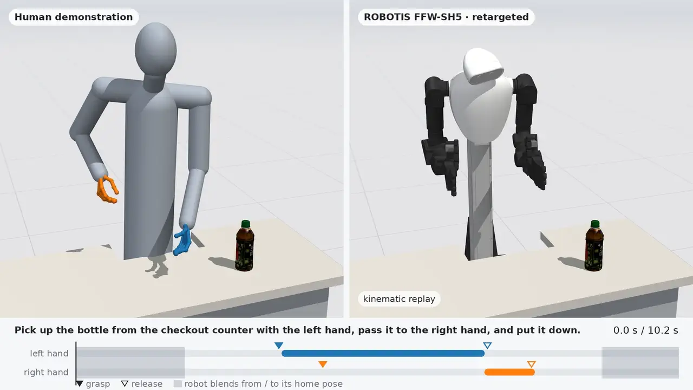
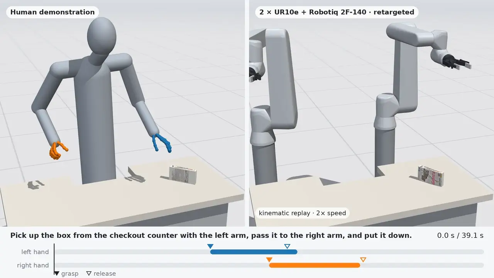

<div align="center">

# ARCADE-Checkout / robots

**Human checkout demonstrations retargeted to robots, as state-only LeRobot datasets: the ROBOTIS AI Worker (FFW-SH5), two UR10e arms with Robotiq 2F-140 grippers, and the Unitree G1 humanoid with Dex3-1 hands.**

[](LICENSE) [](CHANGELOG.md) [](https://www.python.org/) [](https://github.com/huggingface/lerobot)

[](https://huggingface.co/SpaceVision-AI)



<sub>Episode `J03826_left`. Left: the recorded human demonstration. Right: the same episode on the ROBOTIS FFW-SH5,
replayed from the released joint trajectories (kinematic, no physics). On the timeline, bars show which hand carries the
product, triangles the grasp and release events, and the grey bands where the robot blends from and to its home pose. ▶ <a href="docs/media/human_vs_robot.mp4">MP4, 1080p, two episodes</a></sub>

</div>

The robot data of ARCADE-Checkout, released as **ARCADE-Checkout-FFW-SH5**,
**ARCADE-Checkout-UR10e** and **ARCADE-Checkout-G1**: the recorded checkout demonstrations
retargeted to three robots, as state-only LeRobot datasets, with the code that exports and checks
them. It is one of the three
parts of the [ARCADE-Checkout repository](..):

* **[Overview](../README.md)**: what ARCADE is, datasheets and glossary. Start there if you are
  evaluating ARCADE.
* **[`human/`](../human)**: the human data (3-D hands, body, product pose, grasp/release
  events, segmentation masks) of the same recording session.
* **`robots/`** (this directory): the robot versions as LeRobot datasets, the FFW-SH5
  retargeting solver, the LeRobot exporter and a preview renderer.

| robot | `robot_type` | state / action | episodes | sample |
|---|---|---|---|---|
| ROBOTIS AI Worker FFW-SH5: swerve base, lift, 2 × 7-DoF arms, 2 × 20-joint hands, 2-DoF head | `ffw_sh5_rev1` | 60-D | 94 | `samples/lerobot_ffw_sh5_v3.0` |
| two Universal Robots UR10e arms with Robotiq 2F-140 grippers, fixed bases ([details](#two-ur10e--robotiq-2f-140)) | `ur10e_2f140_dual` | 14-D | 45 | `samples/lerobot_ur10e_2f140_v3.0` |
| Unitree G1 humanoid (29 body joints, free-floating pelvis) with Dex3-1 three-finger hands ([details](#unitree-g1--dex3-1)) | `unitree_g1_dex3` | 50-D | 80 | `samples/lerobot_g1_dex3_v3.0` |

## Load the sample with LeRobot

This directory ships 2 episodes per robot (a hand-to-hand pass and a one-hand or one-arm episode) in
both layouts:

```bash
git clone https://github.com/SpaceVision-ai/ARCADE-Checkout.git && cd ARCADE-Checkout/robots
pip install "lerobot[dataset]"          # lerobot >= 0.4 reads codebase v3.0
```

```python
from lerobot.datasets.lerobot_dataset import LeRobotDataset

ds = LeRobotDataset("local/arcade_ffw_sh5", root="samples/lerobot_ffw_sh5_v3.0")
frame = ds[300]
frame["observation.state"].shape          # torch.Size([60])   joint positions (names in ds.meta.features)
frame["observation.environment_state"]    # product pose [x y z qx qy qz qw] + left/right carrying
frame["task"]                             # 'Pick up the bottle from the checkout counter with the left hand, pass it to the right hand, ...'

ur = LeRobotDataset("local/arcade_ur10e_2f140", root="samples/lerobot_ur10e_2f140_v3.0")
ur[300]["observation.state"].shape        # torch.Size([14])   2 x 6 arm joints + 2 gripper finger_joint

g1 = LeRobotDataset("local/arcade_g1_dex3", root="samples/lerobot_g1_dex3_v3.0")
g1[100]["observation.state"].shape        # torch.Size([50])   43 joints (legs, waist, arms, hands) + pelvis pose

chunks = LeRobotDataset("local/arcade_ffw_sh5", root="samples/lerobot_ffw_sh5_v3.0",
                        delta_timestamps={"action": [i / ds.fps for i in range(16)]})
chunks[300]["action"].shape               # torch.Size([16, 60])  an action chunk
```

<details><summary>lerobot 0.3.x (codebase v2.1), GR00T-style tooling</summary>

```bash
pip install "lerobot==0.3.3"
```
```python
ds = LeRobotDataset("local/arcade_ffw_sh5", root="samples/lerobot_ffw_sh5_v2.1")
```
`meta/modality.json` maps the 60-D vector and the product state to named groups.
</details>

<details><summary>Phases of an episode: before the grasp, hold, after</summary>

Each hand is in one of four phases at every step ([definition](../README.md#what-happens-in-an-episode)).
They follow from `source_frame` and the two carrying flags at the end of `observation.environment_state`:

```python
import numpy as np, pyarrow.parquet as pq
t = pq.read_table("samples/lerobot_ffw_sh5_v3.0/data/chunk-000/file-000.parquet")
episode = np.array(t.column("episode_index").to_pylist())
frame = np.array(t.column("source_frame").to_pylist())                                    # session frame of each step
carrying = np.array(t.column("observation.environment_state").to_pylist())[:, 7:9] > 0   # left, right

def phases(frame, carrying, fade=6):
    """Per-hand phase of each step: 0 before the grasp, 1 just before it, 2 hold, 3 after."""
    g = np.floor(frame[carrying.any(1)].min())          # the episode's first grasp (session frame)
    ph = np.where(frame < g - fade, 0, np.where(frame < g, 1, 3))[:, None].repeat(2, 1)
    ph[carrying] = 2
    return ph                                            # (steps, 2): left, right

ph = phases(frame[episode == 1], carrying[episode == 1])  # J03826_left, left hand: 0 steps 0-61, 1 62-69, 2 70-138, 3 139-204
```
A step where one hand goes from 2 to 3 and the other from 3 to 2 is a hand-over. The home
transitions are in the raw outputs (`<hand>__w`, `<hand>__win`, [docs/FORMAT.md](docs/FORMAT.md)).
</details>

<details><summary>Without LeRobot: plain parquet</summary>

```python
import json, numpy as np, pyarrow.parquet as pq
root = "samples/lerobot_ffw_sh5_v3.0"
names = json.load(open(f"{root}/meta/info.json"))["features"]["observation.state"]["names"]
t = pq.read_table(f"{root}/data/chunk-000/file-000.parquet")
state = np.array(t.column("observation.state").to_pylist())     # (433, 60), columns = names
episode = np.array(t.column("episode_index").to_pylist())
```
</details>

## Train a policy

The stock LeRobot trainer runs on the data as is. A smoke test on the sample (CPU, a few minutes):

```bash
pip install "lerobot[training,diffusion]"
lerobot-train --dataset.repo_id=local/arcade_ffw_sh5 --dataset.root=samples/lerobot_ffw_sh5_v3.0 \
    --policy.type=diffusion --policy.push_to_hub=false --policy.device=cpu \
    --steps=20 --batch_size=8 --save_checkpoint=false --output_dir=outputs/smoke
```

<sub>Checked with `lerobot` 0.7.0 (v3.0 sample) and, as `python -m lerobot.scripts.train`, with `lerobot` 0.3.3 (v2.1 sample):
the data loads, the policy builds and the 20 steps run. The same command runs on the UR10e sample
(`--dataset.repo_id=local/arcade_ur10e_2f140 --dataset.root=samples/lerobot_ur10e_2f140_v3.0`) and on the G1 sample
(`--dataset.repo_id=local/arcade_g1_dex3 --dataset.root=samples/lerobot_g1_dex3_v3.0`), both checked with `lerobot` 0.7.0. For real training, use the full datasets on Hugging Face ([FFW-SH5](https://huggingface.co/datasets/SpaceVision-AI/ARCADE-Checkout-FFW-SH5), [UR10e](https://huggingface.co/datasets/SpaceVision-AI/ARCADE-Checkout-UR10e), [G1](https://huggingface.co/datasets/SpaceVision-AI/ARCADE-Checkout-G1)),
each with its `train` split (`meta/info.json -> splits`).</sub>

## What you can use today

| | |
|---|---|
| **In this directory now** | `samples/`: 2 episodes per robot, each in LeRobot v3.0 and v2.1 plus the raw outputs: FFW-SH5 `J02562_right`, `J03826_left`; UR10e `J01160_right`, `J05489_left`; G1 `J02771_right`, `J08320_left`. Also the FFW-SH5 solver, the exporter, the renderer, and the UR10e and G1 robot description fetchers |
| **Full dataset** | FFW-SH5: 94 episodes, 18,119 steps, LeRobot 11 MB (v3.0) / 14 MB (v2.1), raw outputs 9 MB. UR10e: 45 episodes, 42,087 steps, LeRobot 6 MB (v3.0) / 7 MB (v2.1), raw outputs 5 MB. G1: 80 episodes, 10,505 steps, LeRobot 6 MB (v3.0) / 7 MB (v2.1), raw outputs 3 MB. On Hugging Face, gated access: [ARCADE-Checkout-FFW-SH5](https://huggingface.co/datasets/SpaceVision-AI/ARCADE-Checkout-FFW-SH5), [ARCADE-Checkout-UR10e](https://huggingface.co/datasets/SpaceVision-AI/ARCADE-Checkout-UR10e), [ARCADE-Checkout-G1](https://huggingface.co/datasets/SpaceVision-AI/ARCADE-Checkout-G1) |
| **Good for** | prototyping and evaluating state-based policies for a mobile bimanual humanoid with dexterous hands, two industrial arms with parallel grippers, or a whole-body humanoid with three-finger hands (the stock LeRobot trainer runs on all three as is); language-conditioned variants of one task family; retargeting research |
| **Limits** | kinematic trajectories, never run on hardware · FFW-SH5 hand–product contact not modelled ([Quality](#quality-ffw-sh5)) · G1: the grasps are tested in a physics replay, and 45 of the 80 episodes keep the product in every hold ([G1](#unitree-g1--dex3-1)) |

## At a glance: FFW-SH5

| | figure | what it means |
|---|---|---|
| Robot | ROBOTIS AI Worker FFW-SH5 (`robot_type` `ffw_sh5_rev1`): swerve base, lift, 2 × 7-DoF arms, 2 × HX5-D20 hands (20 joints each), 2-DoF head. Description fetched from [`ROBOTIS-GIT/ai_worker@9bc7f7b`](retarget/robotis_ffw_sh5/README.md) | the upstream robot model, not redistributed here |
| Episodes | **94**: 49 hand-to-hand passes, 9 both-hands holds, 35 one-hand, 1 picked up twice; 18,119 steps at 20 fps | the ARCADE-Checkout-Human episodes whose robot motion passes the robot-side check |
| State and action | `observation.state` / `action`: 60-D joint positions. `arm_l` 0–6 · `arm_r` 7–13 · `finger_l` 14–33 · `finger_r` 34–53 · `head` 54–55 · `lift` 56 · `base x, y, yaw` 57–59 ([table](docs/FORMAT.md#state-and-action-layout-60-d)) | the action is the next state: position targets, the usual setup for action-chunking policies |
| Product state | `observation.environment_state`: product pose (7-D) + which hand carries it (2-D) | a state-based policy knows where the product is without a camera |
| Tasks | 11 hand-specific language tasks, one per episode | e.g. *"Pick up the bottle … with the left hand, pass it to the right hand, and put it down."* |
| Speed | 1.22 robot steps per human frame while the robot follows the shopper | where the arm cannot keep up, the robot is slowed down: about 20 % slower than the shopper. `source_frame` maps each step to its human frame |
| Links to the human data | `source_frame` per step, `source_episode_id` per episode | any step can be traced back to the ARCADE-Checkout-Human frame it was made from |
| Splits | time blocks: train 71 / val 8 / test 13 episodes (+2 boundary) | no session frame is shared between splits; random splits would leak, because episodes overlap in time |

## Quality: FFW-SH5

| | result | what it means |
|---|---|---|
| selection | every episode passes an automatic check of the robot motion: collisions that last, a hand below the counter top, arm-branch flips, the carried product leaving the hand | the released motion has none of these failures ([rules](docs/RETARGETING.md#robot-side-check)) |
| IK accuracy | the hand reaches its planned target to **2.4 mm** and **0.6°** (median episode; p90 within an episode 8.3 mm, 2.2°) | the arms go where they are planned to. The planned target is the human hand, shifted to clear the product before the grasp and after the release |
| fingers | fingertip error after the fit: thumb 6, index 9, middle 4, ring 7, little 22 mm (median episode) | the robot hand takes the human hand's shape; the little finger matches least |
| product | the carried product stays within 10 mm of the human product path (median episode's largest deviation; p90 29 mm) | the product moves with the robot hand much as it did with the shopper's |
| contact | part of the hand is more than 5 mm inside the product mesh in 34 % of the holding time; the thumb, or both index and middle fingertips, are more than 1 cm off the surface in 5 % | **contact is not modelled**: a physics replay needs contact refinement before the hand can hold the product |
| joint limits | none of the 253,666 arm-joint samples is beyond the URDF limits; 5.8 % are within 0.05 rad of one | every sample is within the robot's position limits |
| robot model | the MuJoCo replay's links agree with the URDF to 0.0001 mm over 1,000 random configurations | the preview video shows the same kinematics as the data |
| reproducibility | the solver is deterministic; re-running it on the public human data reproduces the quality figures | individual episodes can settle into a different, equally valid solution ([details](docs/RETARGETING.md#reproducibility)) |

Per-episode figures: [docs/RETARGETING.md](docs/RETARGETING.md#quality-figures-94-episodes).

## Retarget it yourself: FFW-SH5

The solver needs no learned model: it fits the robot hands to the human hands, then solves Pink IK
for the arms and the swerve base. It takes about 2 min of CPU per episode:

```bash
pip install -e ../human -e ".[solver,render]"   # Python >= 3.11; the human data reader is next door
bash retarget/robotis_ffw_sh5/fetch_robot.sh                       # ROBOTIS URDF + meshes + MJCF at the pinned commit
python -m arcade_retarget.ffw_sh5       --release ../human/samples/arcade_human_sample --out build/ffw_sh5
python -m arcade_retarget.export_lerobot --retarget build/ffw_sh5 --release ../human/samples/arcade_human_sample \
    --out build/lerobot_ffw_sh5                          # LeRobot v2.1 with the time splits; docs/FORMAT.md converts to v3.0
python -m arcade_retarget.render         --release ../human/samples/arcade_human_sample --retarget build/ffw_sh5 \
    --episodes J03826_left --out build/preview.mp4       # the video above (needs ffmpeg)
```

Pass `--release` to the exporter: it gives the time splits and the task sentences of the human data.
Without it every episode goes to the `train` split, and the exporter warns.

How it works:

1. **Window.** The robot follows the shopper from shortly before the first grasp to shortly after the
   last release. Before and after, it moves from and back to a home pose.
2. **Hands.** Each frame, the robot hand pose and its 20 finger joints are fitted to the human hand
   (fingertip positions first, then finger and palm directions) within the joint limits and without
   finger self-collision.
3. **Clearance.** Before the first grasp and after the last release the wrist path is shifted so the
   hand clears the product and the counter. An idle hand moves toward a rest pose beside the body when
   the working hand comes close.
4. **Whole-body IK** (Pink) for the swerve base and both arms, with torso, counter-edge and hand-to-hand
   barriers. Stretches the arm cannot follow at the shopper's speed are slowed down and solved again.
5. **Finish.** The fingers are refitted from the final wrists, the head camera aims at the working hand,
   and the carried product is attached to the robot hand.

Details: [docs/RETARGETING.md](docs/RETARGETING.md) · formats: [docs/FORMAT.md](docs/FORMAT.md).

## Two UR10e + Robotiq 2F-140

A fixed cell of two Universal Robots UR10e arms with Robotiq 2F-140 parallel grippers, on pedestals
at counter-top height on the shopper's side of the counter. The motion is planned around grasps:
for every interval in which the shopper holds the product, each arm gets a parallel-jaw grasp on
the product, then moves to it, carries the product and hands it over
([method](docs/RETARGETING_UR10E.md)). The robot descriptions come from Universal Robots and
ROS-Industrial at fixed commits ([retarget/universal_robots_ur10e_robotiq_2f140](retarget/universal_robots_ur10e_robotiq_2f140/README.md)).



<sub>Episode `J05489_left`, at 2× speed. Left: the recorded human demonstration. Right: the two UR10e arms replaying the
released joint trajectories (kinematic, no physics). On the timeline, bars show when each gripper holds the product and
triangles the shopper's grasp and release events. ▶ <a href="docs/media/ur10e_human_vs_robot.mp4">MP4, 1080p, two episodes</a></sub>

| | figure | what it means |
|---|---|---|
| Robot | 2 × UR10e (6 joints) + 2 × 2F-140 (`finger_joint`), `robot_type` `ur10e_2f140_dual`; bases fixed 1.0 m apart | `meta/arcade.json` holds the base poses and the gripper mount |
| Episodes | **45**: 28 passes from one arm to the other, 3 held with both arms, 14 done with one arm; 42,087 steps at 20 fps | the episodes in which the shopper uses both hands and the robot motion passes its check ([rules](docs/RETARGETING_UR10E.md#robot-side-check)) |
| State and action | 14-D: `left_*` arm joints 0–5 · `right_*` 6–11 · `left_finger_joint` 12 · `right_finger_joint` 13 ([table](docs/FORMAT.md#lerobot-dataset)) | joint names match the URDF built by `retarget/universal_robots_ur10e_robotiq_2f140/fetch_robot.sh` |
| Product state | product pose (7-D) + which gripper is closed on it (2-D; both during a hand-over) | same layout as FFW-SH5 |
| Tasks | 10 arm-specific language tasks from the robot's own grasps | e.g. *"Pick up the box … with the left arm, pass it to the right arm, and put it down."* |
| Speed | median 3.7 robot steps per human frame | the arms are re-timed to the UR10e joint speed limits and slow down around grasps: the robot is slower than the shopper. `source_frame` gives the session frame of each step |
| Splits | time blocks: train 35 / val 1 / test 8 episodes (+1 boundary) | the same session time blocks as FFW-SH5 |

| quality | result |
|---|---|
| robot model | forward kinematics on the upstream URDF reproduces the recorded gripper poses to 0.0002 mm |
| limits | no joint value beyond the URDF limits; joint speed at most 82 % of the UR10e limit |
| contact | arm meshes never touch; the grippers never come within 4 mm of each other; gripper at most 7.9 mm inside the held product (median episode 0.5 mm) |
| product | moves only while a gripper holds it |

Rebuild the robot description, the LeRobot export and the preview from the shipped raw outputs:

```bash
pip install -e ../human -e ".[robot,render]"
bash retarget/universal_robots_ur10e_robotiq_2f140/fetch_robot.sh                   # upstream UR10e + 2F-140 -> retarget/universal_robots_ur10e_robotiq_2f140/ur10e_2f140_dual.urdf
python -m arcade_retarget.export_lerobot --retarget samples/ur10e_2f140_sample/ur10e_2f140 \
    --out build/lerobot_ur10e_2f140                     # add --release ../data/ARCADE-Checkout-Human for the time splits
python -m arcade_retarget.render --release ../data/ARCADE-Checkout-Human --retarget samples/ur10e_2f140_sample/ur10e_2f140 \
    --episodes J05489_left --stride 2 --out build/ur10e_preview.mp4   # the video above (needs ffmpeg)
```

Formats: [docs/FORMAT.md](docs/FORMAT.md#two-ur10e--robotiq-2f-140).

## Unitree G1 + Dex3-1

A Unitree G1 humanoid with 29 body joints and a free-floating pelvis, with a Dex3-1 three-finger
hand on each arm. It stands where the shopper stood and keeps both feet in place, and its legs, waist,
arms and hands are solved together. For every interval in which the shopper holds the product, each
hand gets a planned three-finger grasp on it. The product keeps its recorded path, smoothed while held
([method](docs/RETARGETING_G1.md)). The robot description comes from Unitree at a fixed commit
([retarget/unitree_g1_dex3](retarget/unitree_g1_dex3/README.md)).


<sub>Episode `J02771_right`. Left: the recorded human demonstration. Right: the Unitree G1 replaying the released joint
trajectories and pelvis pose (kinematic replay), seen from closer than the left panel: the G1 is about 1.3 m tall, and the
counter top is 0.80 m above the floor. On the timeline, bars show when each hand holds the product and triangles the
shopper's grasp and release events. ▶ <a href="docs/media/g1_human_vs_robot.mp4">MP4, 1080p, two episodes</a></sub>

| | figure | what it means |
|---|---|---|
| Robot | Unitree G1 (29 body joints) + 2 × Dex3-1 (7 joints each), `robot_type` `unitree_g1_dex3`; free-floating pelvis, feet fixed | joint names are the URDF names of `g1_29dof_with_hand_rev_1_0` |
| Episodes | **80**: 38 passes from one hand to the other, 10 held with both hands, 32 one-hand; 10,505 steps at 20 fps | the episodes that pass the robot-side check ([rules](docs/RETARGETING_G1.md#robot-side-check)) |
| State and action | 50-D: legs 0–11 · waist 12–14 · left arm 15–21 · left hand 22–28 · right arm 29–35 · right hand 36–42 · pelvis pose 43–49 ([table](docs/FORMAT.md#unitree-g1--dex3-1)) | the pelvis pose `[x, y, z, qx, qy, qz, qw]` is in the robot world |
| Product state | product pose (7-D) + which hand holds it (2-D; both during a hand-over) | same layout as the other robots |
| Physics | `physics_all_held` per episode: **45 of 80** keep the product in every hold in a MuJoCo replay of the grasps | filter on it to train only on grasps that also carried the product in simulation |
| Tasks | 12 hand-specific language tasks from the robot's own holds | e.g. *"Pick up the box … with the left hand, pass it to the right hand, and put it down."* |
| Speed | follows the shopper's clock (median 1.03 robot steps per human frame); slowed around hand-over grabs in 40 episodes | `source_frame` gives the session frame of each step |
| Splits | time blocks: train 63 / val 6 / test 9 episodes (+2 boundary) | the same session time blocks as the other robots |

| quality | result |
|---|---|
| robot model | forward kinematics on the upstream URDF reproduces the recorded fingertip points; the MuJoCo model agrees with the URDF to 0.002 mm |
| balance | centre of mass inside the support polygon of both feet at every step; feet stay in place (largest movement 2.3 mm) |
| limits | no joint value beyond the URDF limits; legs, waist and arms at most 44 % of their URDF velocity limits; the Dex3-1 thumb rotation joint exceeds its 3.14 rad/s limit in 11 % of steps (up to 5.1 rad/s) |
| contact | the robot hand grips the product in 99.9 % of its holding steps; no 3-step run of a hand more than 5 mm inside the product, or of the hands within 4 mm of each other |

Rebuild the LeRobot export and the preview from the shipped raw outputs:

```bash
pip install -e ../human -e ".[render]"
bash retarget/unitree_g1_dex3/fetch_robot.sh                       # upstream G1 + Dex3-1 URDF, MJCF and meshes
python -m arcade_retarget.export_lerobot --retarget samples/g1_dex3_sample/g1_dex3 \
    --out build/lerobot_g1_dex3                         # add --release ../data/ARCADE-Checkout-Human for the time splits
python -m arcade_retarget.render --release ../data/ARCADE-Checkout-Human --retarget samples/g1_dex3_sample/g1_dex3 \
    --episodes J02771_right --out build/g1_preview.mp4   # the video above (needs ffmpeg; --robot-zoom 1: same view as the human panel)
```

Formats: [docs/FORMAT.md](docs/FORMAT.md#unitree-g1--dex3-1).

## Citation and license

* Cite via [`CITATION.cff`](../CITATION.cff) at the repository root.
* The code and the data are released under [CC BY-NC 4.0](LICENSE) (Creative Commons
  Attribution-NonCommercial 4.0): non-commercial use with attribution. For commercial use, write to
  [contact@space-vision.ai](mailto:contact@space-vision.ai).
* The full datasets on Hugging Face are under the same license: [FFW-SH5](https://huggingface.co/datasets/SpaceVision-AI/ARCADE-Checkout-FFW-SH5), [UR10e](https://huggingface.co/datasets/SpaceVision-AI/ARCADE-Checkout-UR10e), [G1](https://huggingface.co/datasets/SpaceVision-AI/ARCADE-Checkout-G1).
* Third-party components keep their own licenses and are listed in
  [THIRD_PARTY_LICENSES.md](THIRD_PARTY_LICENSES.md); the solver's optional QP backend is GPL and is not
  needed to use the data.
* The ROBOTIS, Universal Robots, Robotiq and Unitree robot descriptions are fetched, not redistributed.
  The robot meshes in the images and videos stay under their makers' licenses
  ([THIRD_PARTY_LICENSES.md](THIRD_PARTY_LICENSES.md#robot-images-and-videos)).
* The license covers our measurements and annotations. The packaging artwork in the product mesh textures
  belongs to the product makers and is not licensed under CC BY-NC 4.0.

---

<sub>[Overview](../README.md) · [human](../human) (human data) · **robots** (robot data)</sub>
